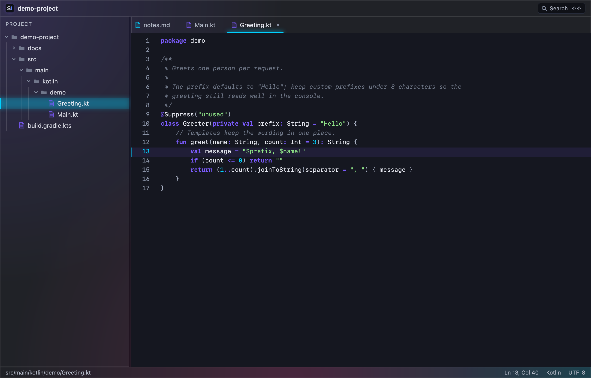
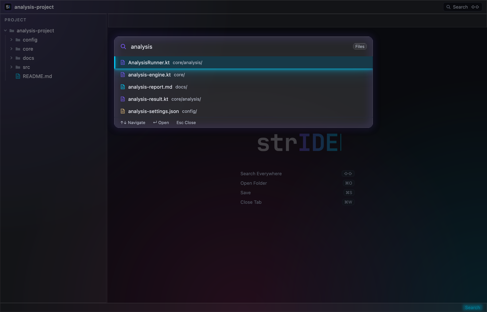
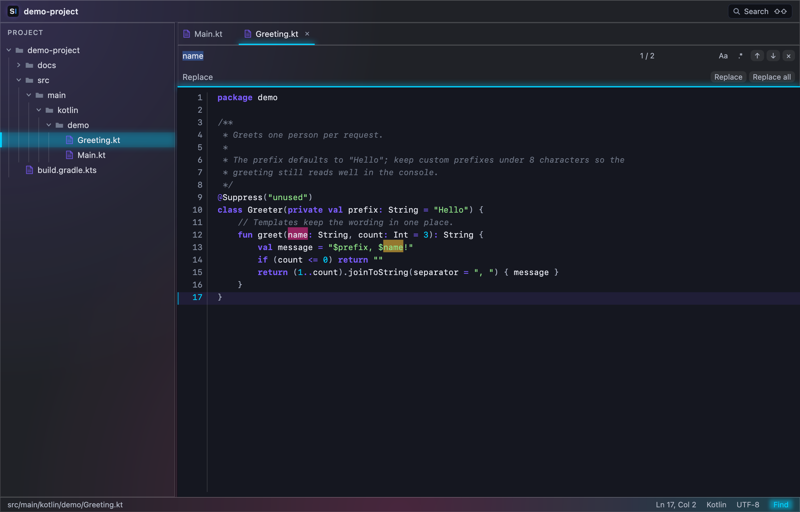
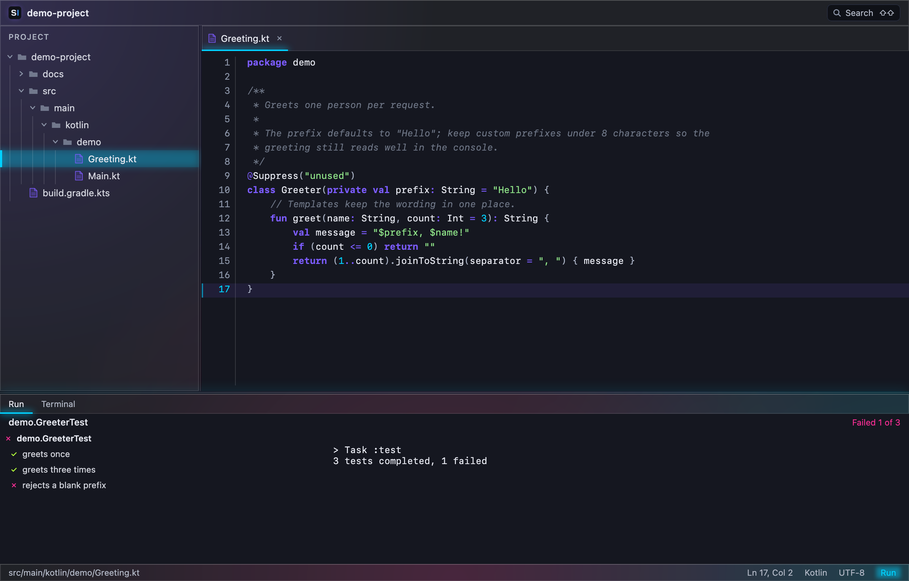
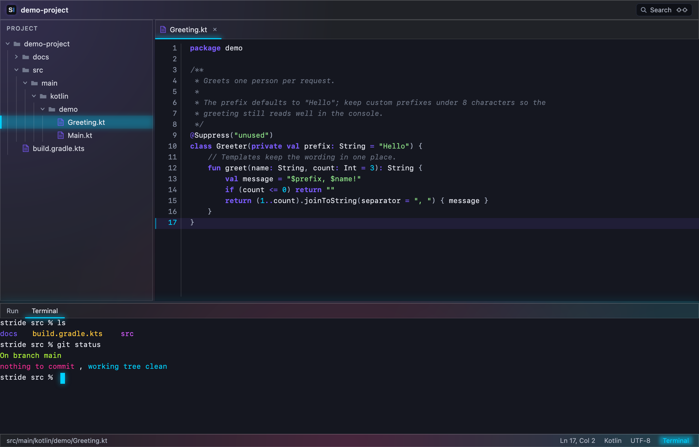

<h1 align="center">strIDE</h1>

<p align="center">A keyboard-driven code editor for macOS.</p>

<p align="center"><a href="README.md">한국어</a> · <b>English</b></p>

<p align="center">
  <a href="https://github.com/lcalmsky/stride/releases/latest"></a>
  
  <a href="LICENSE"></a>
</p>

<p align="center"></p>

<p align="center">
  Project tree &nbsp;·&nbsp; tabbed editor &nbsp;·&nbsp; Kotlin and JSON syntax highlighting &nbsp;·&nbsp; find and replace &nbsp;·&nbsp; neon and glass UI<br>
  Built with Kotlin and Compose Desktop for Apple Silicon.
</p>

<br>

## Quick start

```sh
brew tap lcalmsky/stride https://github.com/lcalmsky/stride
brew trust lcalmsky/stride
brew install --cask lcalmsky/stride/stride
```

The app installs to `/Applications/strIDE.app`. It is Apple Silicon (arm64) only, and the bundled runtime means you do not need to install a JDK.

<br>

## Features

### Editor

<table width="100%">
<tr>
<td width="44%" valign="top"></td>
<td valign="top">

- **Project tree** a directory expands on a single click and a file opens on a single click. `.git`, `build`, `.gradle`, `node_modules`, `.kotlin`, and `.idea` are hidden. Drag the splitter to set the width between 200 and 480 dp
- **Tabbed editor** open files become tabs, and opening the same file again selects its tab. Close with `⌘W` and switch with `⌘⇧]`·`⌃→` and `⌘⇧[`·`⌃←`
- **Syntax highlighting** the Kotlin and JSON plugins each provide a lexer and a highlighter. Files larger than 2 MB open read-only without highlighting
- **Editing** duplicate, delete, and move lines, toggle line and block comments, indent, and undo or redo from the keyboard. `⌘L` jumps to a `line` or `line:column`
- **Status bar** shows the relative path, `Ln`·`Col`, the file type, `UTF-8`, and a read-only badge

</td>
</tr>
</table>

### Search

<table width="100%">
<tr>
<td width="44%" valign="top"></td>
<td valign="top">

- **Search Everywhere** press `Shift` twice to open it. It matches file names and relative paths fuzzily and lists them by score; move with `↑`·`↓` and open with `Enter`
- **Go to file** `⌘⇧O` opens the same result window
- **Find in path** `⌘⇧F` searches the text of every project file. It skips files over 2 MB and binary files and shows up to 200 results. Each row reads `path:line` with the line body, and the matched characters are highlighted. `Enter` opens the file and selects the match
- **Recent files** `⌘E` lists the most recently opened files, newest first, up to 50. Closed files stay in the list

</td>
</tr>
</table>

### Find

<table width="100%">
<tr>
<td width="44%" valign="top"></td>
<td valign="top">

- **Find bar** `⌘F` opens it below the tab strip. `Enter`·`⌘G` moves to the next match and `⇧Enter`·`⌘⇧G` to the previous one, wrapping around at either end
- **Replace** `⌘R` expands the replace row. Replace the current match or all matches
- **Options** `Aa` matches case and `.*` uses a regular expression. In regular-expression replacements, `$1` refers to a group. An invalid expression shows an error
- **Display** the current match and the other matches are painted in different neon colors, with an `n / total` counter. `Esc` closes the bar and returns focus to the editor

</td>
</tr>
</table>

### Run

<table width="100%">
<tr>
<td width="44%" valign="top"></td>
<td valign="top">

- **Running tests** every class line and `@Test` function in a `.kt` file under `src/test` gets a `▶` in the gutter; click it to run that test. `⌃⇧R` runs the test at the caret, and `⌃R` reruns the last run or runs the test at the caret
- **Test tree and console** below the header status, the Run window splits into the test tree and the console. It counts passed, failed, and skipped tests, and selecting a method shows its message, stack, and captured output
- **Stop and rerun** `⌘F2` stops the run and `⌘R` reruns it from the Run window. `⌘4` opens the Run window
- **Always runs** the Gradle init script disables up-to-date checks and the build cache for every `Test` task, so running the same test again still executes it and reports its events

</td>
</tr>
</table>

### Terminal

<table width="100%">
<tr>
<td width="44%" valign="top"></td>
<td valign="top">

- **Built-in terminal** `⌥F12` opens the Terminal window. It runs the login shell in the project directory over a real PTY (pty4j), and jediterm draws the screen
- **Neon ANSI palette** the 16 ANSI colors belong to the same neon family as the rest of the window. The cursor is `accent2`
- **Hide** `⇧Esc` hides the window and returns focus to where it was

</td>
</tr>
</table>

### Neon and glass UI

<table width="100%">
<tr>
<td width="44%" valign="top"></td>
<td valign="top">

- **Mesh background** three radial orbs (violet, cyan, and pink) are drawn over the dark base and sit behind the window content
- **Glass panels** the project tree, tab strip, and find bar are translucent panels cut from a blurred slice of the mesh. Result popups and the go-to-line popup use glass that blurs the content actually drawn beneath them
- **Neon selection signal** a selected row, tab, or result gets a faint cyan background, an `accent2` bar on the left (bottom for tabs), and a bleeding glow. A focused panel draws a thin neon line along its top edge
- **Transitions** a glow fades for 150 ms only when the selection changes. Nothing else animates continuously
- **Cost** panel blur is computed once per size and cached, and the popup backdrop blur runs on a quarter-resolution copy. The editor, terminal, and console use an opaque tint, so the mesh does not show through them

</td>
</tr>
</table>

<br>

## Usage

### Keyboard

These are the default keys. Shortcuts are compatible with the IntelliJ IDEA macOS default keymap. The full list and the context precedence are defined by the `bind(` calls in `app/src/main/kotlin/stride/app/keys/Keymap.kt`.

| Key | Action |
|---|---|
| `⌘O` | Open folder |
| `⌘S` | Save |
| `⌘W` | Close tab |
| `⌘⇧]` `⌃→` / `⌘⇧[` `⌃←` | Next tab / previous tab |
| `⇧⇧` | Search Everywhere |
| `⌘⇧O` | Go to file |
| `⌘⇧F` | Find in path |
| `⌘E` | Recent files |
| `⌘F` | Open the find bar |
| `⌘R` | Expand the replace row |
| `⌘G` / `⌘⇧G` | Next match / previous match |
| `⌘D` | Duplicate the line or selection |
| `⌘⌫` | Delete the line |
| `⌥⇧↑` / `⌥⇧↓` | Move the line up / down |
| `⌘/` · `⌘⌥/` | Toggle line comment · toggle block comment |
| `Tab` / `⇧Tab` | Indent / unindent |
| `⌘L` | Go to line |
| `⌘Z` / `⌘⇧Z` | Undo / redo |
| `⌃R` | Rerun the last run, otherwise run the test at the caret |
| `⌃⇧R` | Run the test at the caret |
| `⌘F2` | Stop the run |
| `⌘4` · `⌥F12` · `⇧Esc` | Run window · Terminal window · hide the tool window |

<br>

## Installation

### Homebrew

```sh
brew tap lcalmsky/stride https://github.com/lcalmsky/stride
brew trust lcalmsky/stride
brew install --cask lcalmsky/stride/stride
```

The repository is its own tap and the cask lives in `Casks/stride.rb`. The short name `stride` can collide with another tap, so install with the full `lcalmsky/stride/stride` name. `brew trust` marks a non-official tap as trusted so Homebrew may load its casks.

### Build from source

```sh
git clone https://github.com/lcalmsky/stride.git
cd stride
./gradlew :app:run                       # development run
./gradlew :app:createDistributable       # app/build/compose/binaries/main/app/strIDE.app
```

JDK 21 is required; the Gradle toolchain asks for 21.

### Requirements

| Requirement | Notes |
|---|---|
| macOS Apple Silicon (arm64) | The release app is arm64 only. The bundled runtime means no JDK installation is needed |
| JDK 21 | Needed only to build from source |
| Gatekeeper | When you download and unzip the app yourself, the first launch may show a warning. Right-click the app in Finder and choose `Open` |

<br>

## How it works

The app is split into six modules. `core` provides services, extension points, and `Disposer`; `lang` defines the language, file type, highlighter, and commenter APIs. `search` holds the file name index and the Search Everywhere model, and `app` contains the Compose Desktop UI with the editor, tree, Run window, and terminal. `plugins/lang-kotlin` and `plugins/lang-json` register the Kotlin and JSON lexers, highlighters, and file types.

Every module declares extension points and registers extensions through a `META-INF/stride-plugin.xml` descriptor. The app descriptor opens the file type, syntax highlighter, commenter, editor, tree structure, and Search Everywhere contributor extension points, and the language plugins and the app itself register into them. The full contracts are in [core](docs/api-core.md) · [lang](docs/api-lang.md) · [search](docs/api-search.md) · [app](docs/api-app.md).

<br>

## Development

```sh
./gradlew test                    # tests; must report zero failures
./gradlew :app:createDistributable
./gradlew :app:run                # opens a window, so run it yourself
```

- The tests number about 340 and take roughly 70 seconds. `UiSnapshotTest` writes screen PNGs to `app/build/ui-snapshots/`
- Release with `scripts/release.sh X.Y.Z -m "<summary of changed features>"`. `scripts/release-selftest.sh` checks that script
- Repository rules are in [CLAUDE.md](CLAUDE.md)

<br>

<p align="center"><a href="LICENSE">MIT</a></p>
