<h1 align="center">strIDE</h1>

<p align="center">A keyboard-driven code editor for macOS.</p>

<p align="center"><a href="README.md">한국어</a> · <b>English</b></p>

<p align="center">
  <a href="https://github.com/lcalmsky/stride/releases/latest"></a>
  
  <a href="LICENSE"></a>
</p>

<p align="center">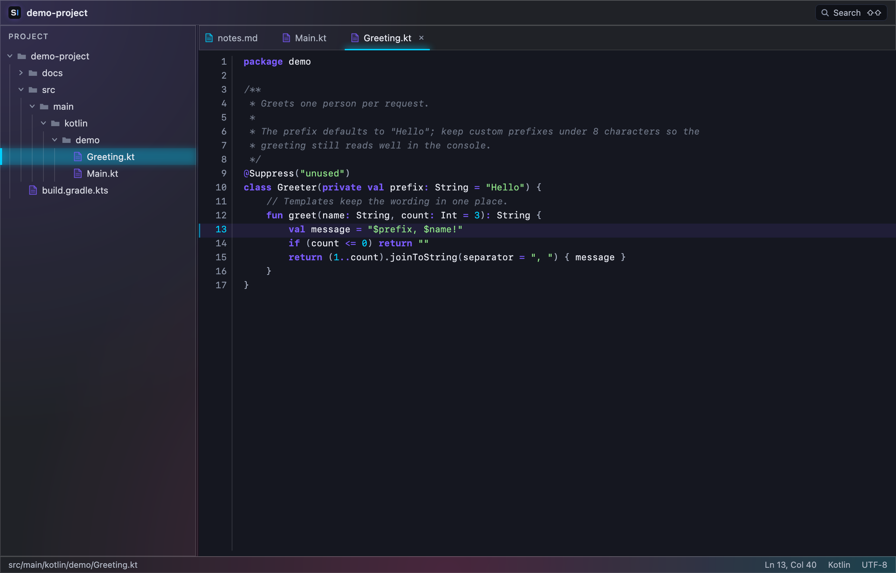</p>

<p align="center">
  Project tree &nbsp;·&nbsp; tabbed editor &nbsp;·&nbsp; Kotlin and JSON syntax highlighting &nbsp;·&nbsp; find and replace &nbsp;·&nbsp; liquid glass UI<br>
  Built with Kotlin and Compose Desktop for Apple Silicon.
</p>

<br>

## Quick start

```sh
brew tap lcalmsky/stride https://github.com/lcalmsky/stride
brew trust lcalmsky/stride
brew install --cask lcalmsky/stride/stride
```

The app installs to `/Applications/strIDE.app`. It is Apple Silicon (arm64) only, and the bundled runtime means you do not need to install a JDK.

<br>

## Features

### Editor

<table width="100%">
<tr>
<td width="44%" valign="top"><br><br>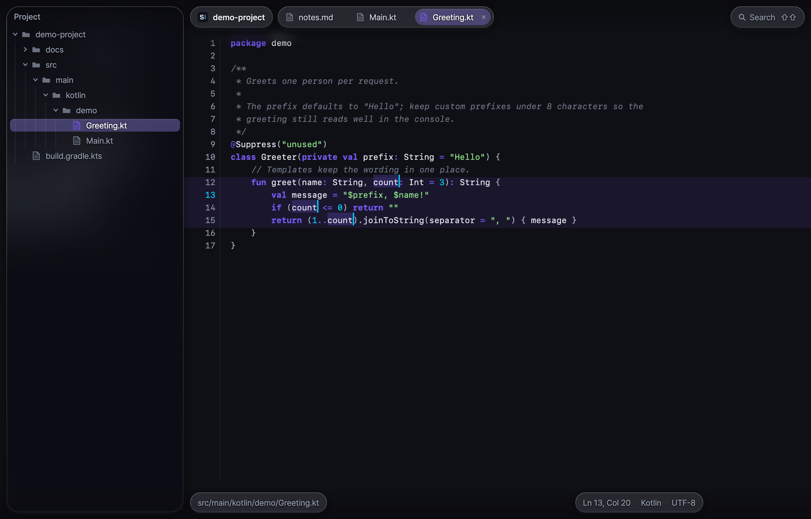<br><br>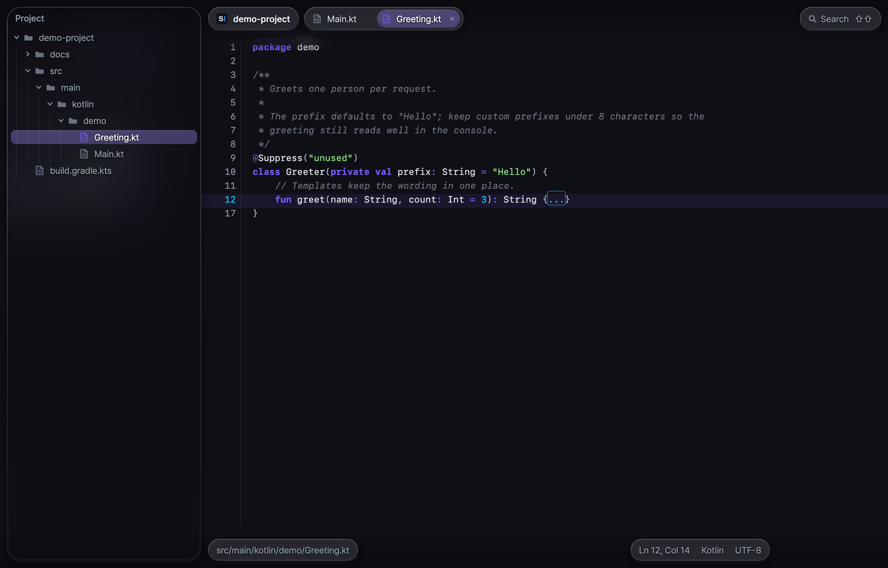<br><br>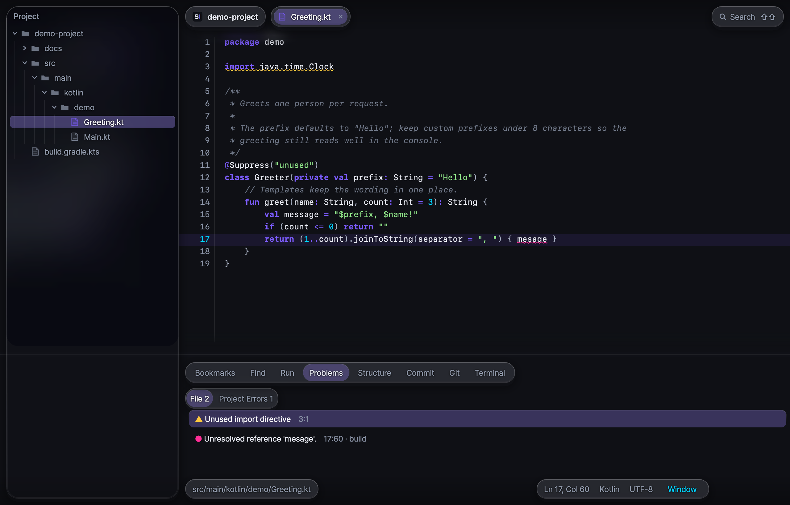<br><br>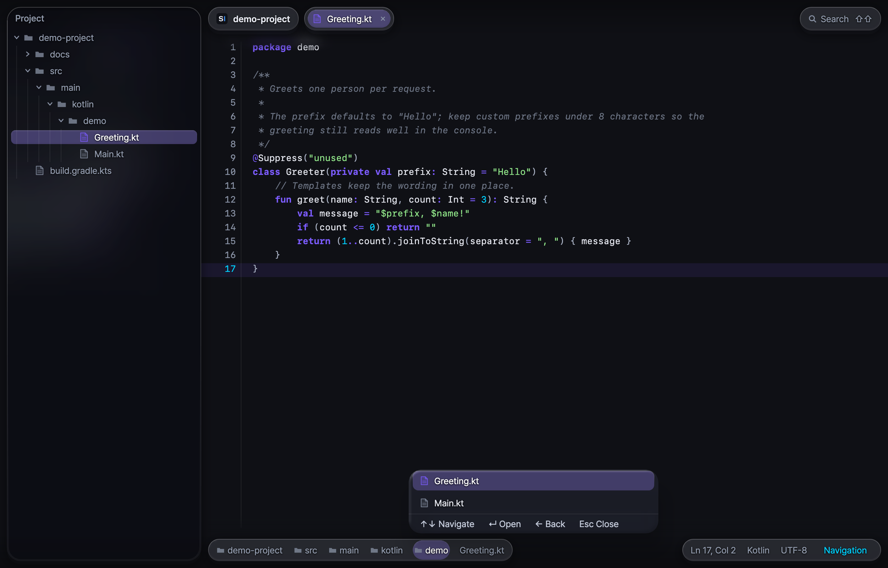<br><br>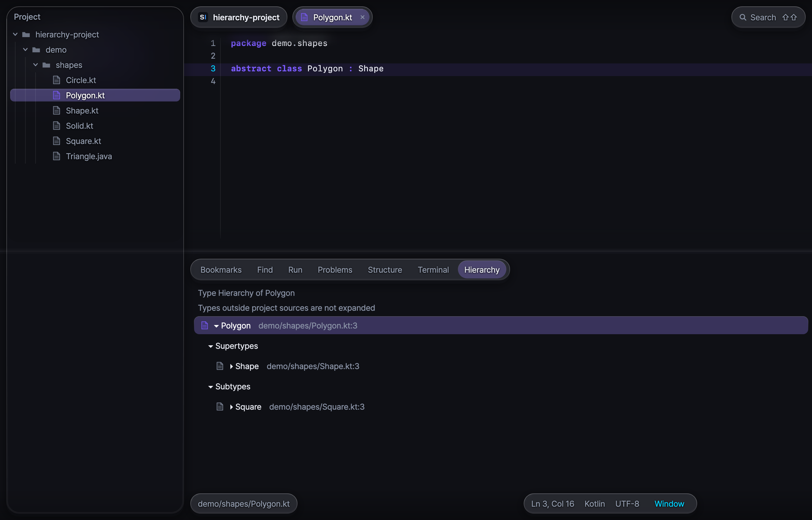<br><br>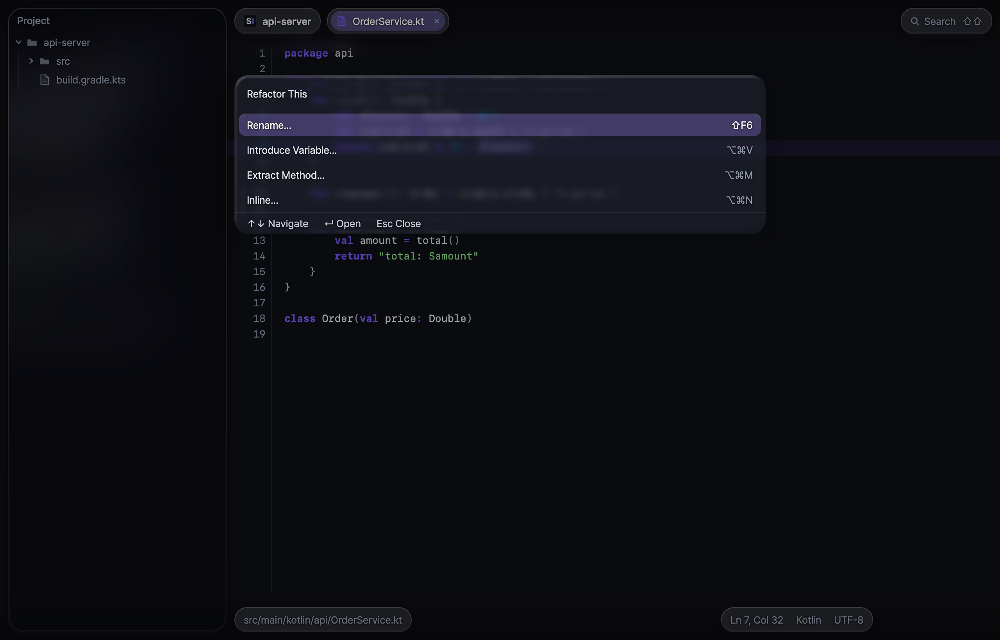<br><br>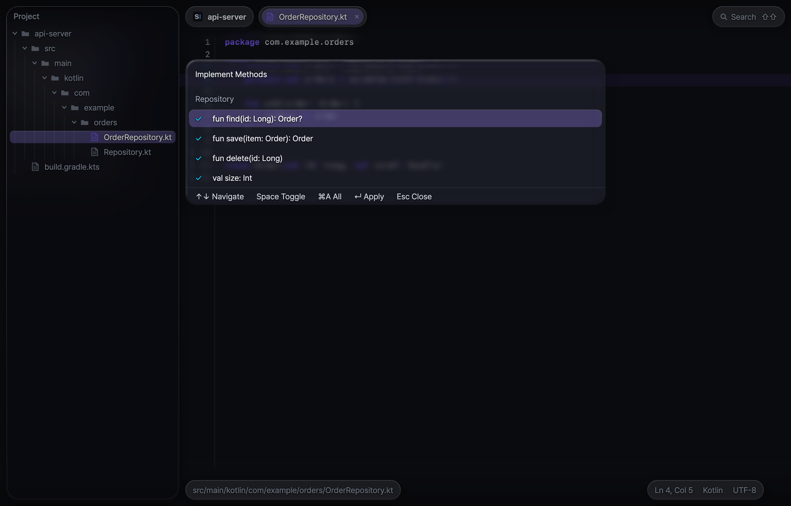" width="480"></td>
<td valign="top">

- **Project tree** a directory expands on a single click and a file opens on a single click. `.git`, `build`, `.gradle`, `node_modules`, `.kotlin`, and `.idea` are hidden. Drag the splitter to set the width between 200 and 480 dp, `⌘1` toggles the tree, and `⌥F1` reveals the current file in it
- **Tabbed editor** open files become tabs, and opening the same file again selects its tab. Close with `⌘W` and switch with `⌘⇧]`·`⌃→` and `⌘⇧[`·`⌃←`. `Reopen Closed Tab` and `Close Other Tabs` in the Actions tab bring back a closed tab or close the rest
- **Syntax highlighting** the Kotlin and JSON plugins each provide a lexer and a highlighter. Files larger than 2 MB open read-only without highlighting
- **Editing** duplicate, delete, and move lines, toggle line and block comments, indent, and undo or redo from the keyboard. `⌘L` jumps to a `line` or `line:column`. With no selection, `⌘C`·`⌘X` copy or cut the whole line, and `⌘⇧V` pastes one of the last 20 copied texts
- **Statement editing** `⌘⇧↑`·`⌘⇧↓` swap a statement, together with its block and the comments and annotations right above it, with its neighbor in the same block. `⌘⇧↩` closes open brackets and opens a block on lines such as `if` or `fun` to finish the statement, and `⌘⇧⌦` unwraps the `if`, `else`, `for`, `while`, `do`, or `try` around the caret and keeps only its body. `⌘⌥T` surrounds the selected lines with a template such as `if` or `try / catch` (Kotlin and Java)
- **Code cleanup** `⌘⌥L` recomputes indentation from bracket depth and tidies trailing whitespace and runs of blank lines (Kotlin, Java, and JSON; other files get the whitespace cleanup only). It never moves line breaks. `⌃⌥O` removes unused and duplicate imports in Kotlin files and sorts them in IntelliJ's default order. `⌃L` scrolls the caret line to the middle of the view
- **Code info** `⌘P` shows the parameter list of the call at the caret with the current parameter highlighted, and keeps following the caret while you type. `F1`·`⌃J` show the KDoc or comment above the declaration, and `⌥Space` shows its source in a popup. Declarations come from the current file and the declaration index
- **Editing helpers** `⌥↑`·`⌥↓` grow and shrink the selection from the caret through word, string contents, brackets, and lines. `⌘⇧U` changes case, `⌃⇧J` joins lines, `⇧↩`·`⌘⌥↩` start a new line, `⌃M` jumps to the matching brace, `⌘⌥[`·`⌘⌥]` move to the code block edges, and `⌃⇧↑`·`⌃⇧↓` move between methods. `⌥/` completes from words in open editors, `⌃Space`·`⌃⌥Space` complete from the declaration index and keywords, `⌃⇧Space` narrows the candidates to classes in a type position and to symbols in an expression position, and `⇧F6` renames within the file
- **Refactorings** `⌃T` lists only the refactorings that apply at the caret — `Rename…`, `Introduce Variable…`, `Extract Method…`, `Inline…` — with their shortcuts. `⌥⌘V` introduces a variable: without a selection it offers the candidate expressions, and it can replace the other occurrences of the same expression too. `⌥⌘M` extracts the selected statements or expression into a `private fun` and works out its inputs and outputs, and `⌥⌘N` inlines a local `val` or a function declared in the same file (Kotlin files only). With no compiler, a refactoring runs only when the text proves the result means what the code meant; otherwise it states the reason in one line in the status bar — an expression that runs only in some cases, an input whose type is unknown, a variable narrowed by a type check, a lambda where a receiver would change — and changes nothing. One undo reverts an applied change
- **Generate** `⌘N` (or `⌃↩`) lists only what can be generated in the class at the caret — `Secondary Constructor…`, `equals() and hashCode()…`, `toString()…`, `Override Methods…`, `Implement Methods…` — and `⌃O` and `⌃I` open the members to override or implement directly. In the member chooser, `Space` checks a row, `⌘A` checks them all and `↵` inserts them. Supertypes are read from project sources, so `save(item: T)` of `Repository<Order>` is written as `save(item: Order)` with the imports it needs; concrete members call `super` (`*xs` for a vararg, `super<A>` when two supertypes supply the member) and abstract ones get `TODO("Not yet implemented")`. When the result could change quietly — a new constructor that would take over an existing `A(1)` call (a constructor with defaults or a vararg, a companion `invoke`, a top-level function of the same name), or a member a library class may already implement — it states the reason in the status bar and inserts nothing (Kotlin files only; members of library supertypes are not listed). One undo reverts a generation
- **Multiple carets** `⌃G` adds the next match to the selection (or selects the word at the caret when there is none), `⌃⇧G` drops the last added one, and `⌃⌘G` selects every match. `⌥⇧`-click adds or removes a caret, and holding the second `⌥` while pressing `↑`·`↓` clones a caret; `⌥`-drag or the `⌘⇧8` column selection mode builds a rectangular selection. Typing, deleting, pasting, arrow movement, and line comment, duplicate, delete, indent and case apply at every caret; any other action drops the secondary carets and works at the primary one. `Esc` drops the secondary carets
- **Code folding** `⌘-` collapses the block that starts on the caret line or encloses the caret into `{...}`, and `⌘=` expands it again. `⌘⇧-`·`⌘⇧=` collapse and expand every block in the file, and the numeric keypad `⌘+`·`⌘-` work too. Multi-line `{}`·`[]` blocks, block comments and KDoc, and the import list fold (Kotlin, Java, JSON). `←`·`→` step over a folded range, and clicking the placeholder or moving the caret into a fold by going to a line, find or navigation expands it. The numbers of folded lines drop out of the gutter
- **Navigation** `⌘B` or `⌘`-click goes to a declaration, and `⌘[`·`⌘]` or `⌘⌥←`·`⌘⌥→` move back and forward. `⌘F12` shows the file structure and `⌘⇧T` goes to the test; `⌥F7` lists usages in a Find window tab, the `⌘2` Bookmarks window and the `⌘7` Structure window list bookmarks and declarations, and `F3`·`⌘F3` handle bookmarks. `⌘⇧F7` highlights the usages of the word at the caret in the current file; while they are highlighted `⌘G`·`⌘⇧G` move between them, and `Esc` or an edit clears them. `⌘⇧⌫` goes to the last place you edited, and pressing it again goes to the place edited before that (the last 50 places, across files). `F4` goes to the declaration at the caret, and in a list window `F4`·`⌘↓` open the selected row and hand the keyboard to the editor
- **Hierarchy navigation** `⌘⌥B` finds the implementations of an interface, abstract class, or its members in the project sources and opens the only one or lists the candidates when there are several. `⌘U` goes to the super method, or, in a class, to its superclasses and interfaces. `⌘⇧B`·`⌃⇧B` go to a type declaration, following only a type the text states or a constructor call, and state the reason in the status bar when the type would need inference. `⌃H` opens the Hierarchy window with the supertype and subtype tree, and `⌃⌥H` opens the caller and callee tree. A node's children are searched when it is expanded, and `←`·`→` collapse and expand it. Calls are matched by name and visibility without a compiler, so a declaration of the same name elsewhere can be mixed in, and the window header says so. Types outside the project (libraries) are not expanded. Unsaved edits are reflected too: an open editor's text is what the actions read for supertypes and locations. When a call or type name resolves to several declarations, they do not pick the first candidate but open a tree with one root per candidate
- **Navigation bar** `⌥Home` (and `⌘↑` in a list window) splits the bottom path capsule into project, folder and file segments. `←`·`→` pick a segment and `↓`·`Enter` list that folder's children above the capsule. Choosing a file in the list opens it, choosing a folder steps into it, and `Esc` closes. In the editor `⌘↑`·`⌘↓` still move to the document start and end
- **Problems** problems judged from the text alone, without a compiler, are shown together with the compiler messages of the last Gradle run. Kotlin and JSON report unbalanced brackets as errors and Kotlin reports unused imports as warnings, recomputed once typing pauses for 300 ms. Errors get a pink and warnings an amber wavy underline. `F2`·`⇧F2` go to the next and previous problem in the current file (errors only when there are any, wrapping around at the ends), and `⌘F1` shows the description of the problem at the caret in a popup. The `⌘6` Problems window splits the current file's problems (File) and the project's errors (Project Errors) into tabs, and `⌘⇧]`·`⌘⇧[` switch them while the window has the keyboard. A build message is shown only while its line can still be matched with certainty after later edits
- **Status capsules** the path capsule at the bottom shows the relative path, and the status capsule group shows `Ln`·`Col`, the file type, `UTF-8`, and a read-only badge

</td>
</tr>
</table>

### Search

<table width="100%">
<tr>
<td width="44%" valign="top">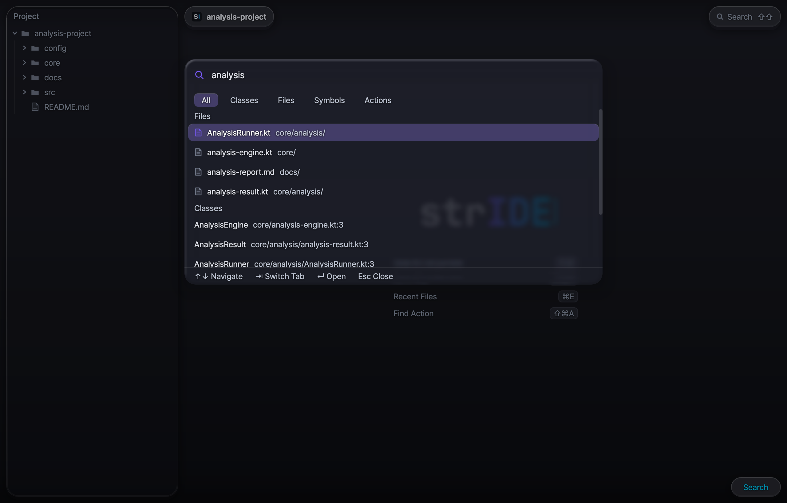<br><br>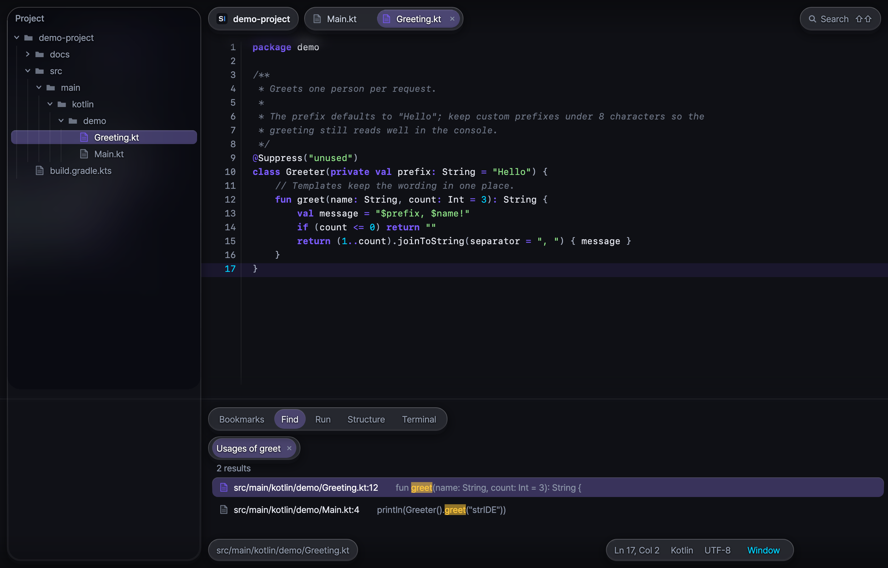<br><br>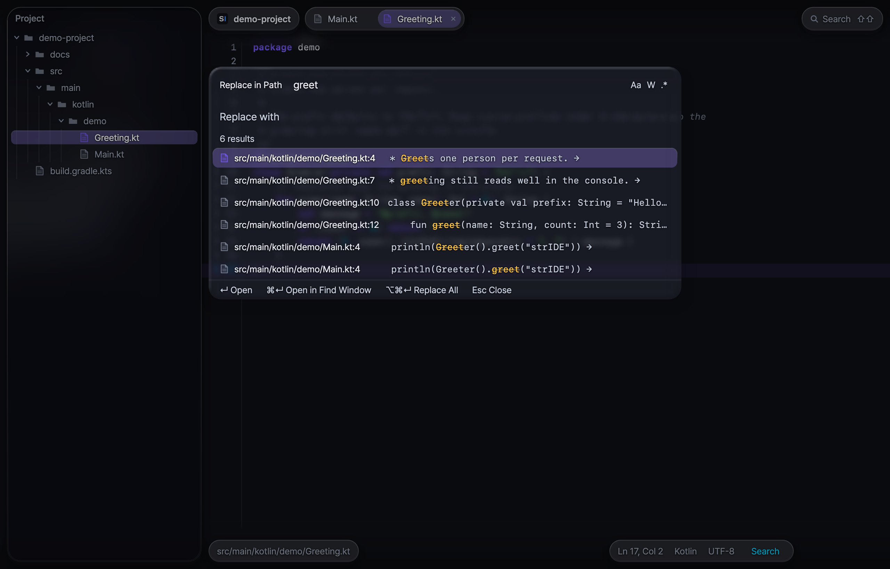<br><br>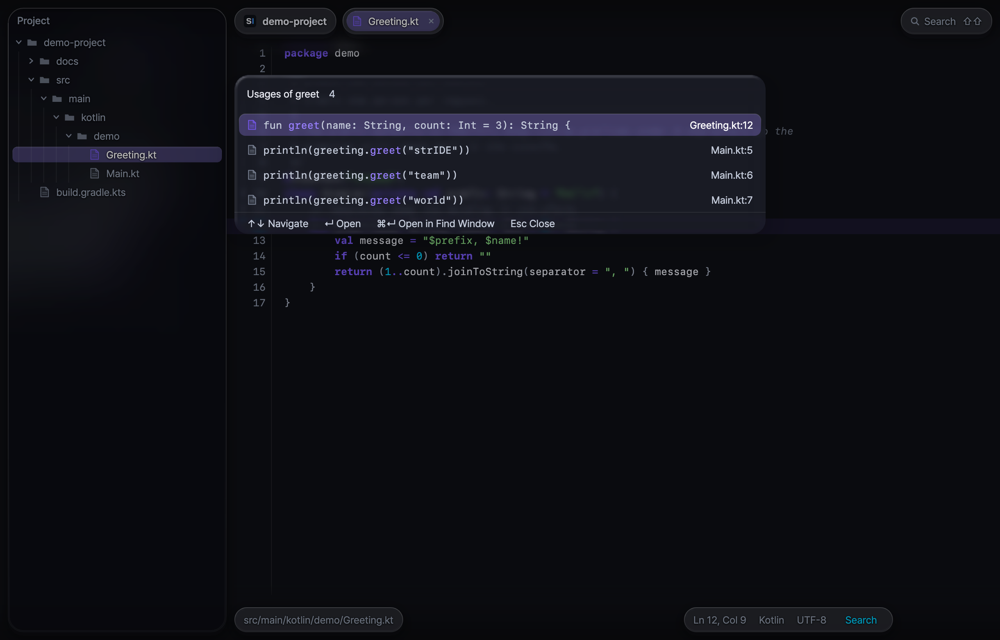<br><br>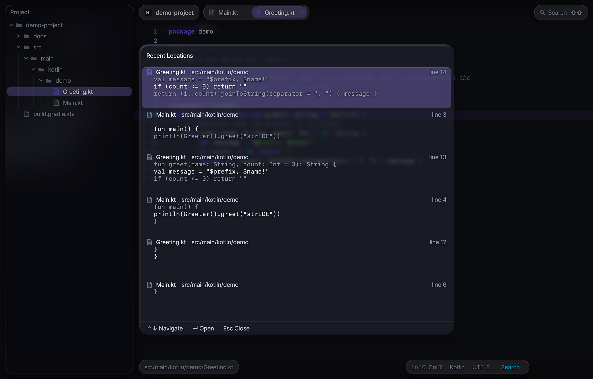</td>
<td valign="top">

- **Search Everywhere** press `Shift` twice to open the All tab. It groups file, class, symbol, and action results (`Files`, `Classes`, and so on, up to 4 per contributor and 50 overall); `Tab`·`⇧Tab` cycle through the All·Classes·Files·Symbols·Actions tabs. Move with `↑`·`↓` and open with `Enter`
- **Classes and symbols** `⌘O` opens class search and `⌘⌥O` opens symbol search. A background declaration index scans Kotlin and Java classes, functions, and properties, shows `path:line` for classes and `container — path:line` for symbols, and `Enter` opens that line
- **Go to file** `⌘⇧O` matches file names and relative paths fuzzily and lists them by score
- **Actions** `⌘⇧A` lists every action with its name and shortcut and runs the chosen one
- **Find in path** `⌘⇧F` searches the text of every project file. It skips files over 2 MB and binary files and shows up to 200 results. `W` turns on whole-word matching. Each row reads `path:line` with the line body, and the matched characters are highlighted. `Enter` opens the file and selects the match
- **Find window** `⌘3` opens the results window. `⌥F7` find usages and `⌘↵` in the find-in-path popup add result tabs, and up to 10 tabs are kept. Rows are not grouped by file: each reads `path:line` with the line body, `↑`·`↓` move, `Enter` opens, and while the Find window has the keyboard `⌘W` closes the selected result tab instead of the editor tab
- **Show Usages** `⌘⌥F7` shows the same search as `⌥F7` (whole word, case-sensitive) in a popup. It lists up to 200 results, each with the line (match highlighted) and `file:line`. `Enter` opens one, and `⌘↵` moves on to the same Find window tab `⌥F7` opens
- **Replace in path** `⇧⌘R` replaces text across the project. A row shows the removed text struck through next to the replacement; `⌥⌘↵` goes through a confirmation row and replaces everything, and `⌘↵` opens the replacement preview as a Find window tab. Files open in an editor are edited without saving and one `⌘Z` per file undoes the change, while files written to the disk cannot be undone and the confirmation row states how many there are. Files that are not UTF-8 are skipped
- **Recent files** `⌘E` lists the most recently opened files, newest first, up to 50. Closed files stay in the list
- **Recent locations** `⌘⇧E` lists the places in the navigation history, newest first, each with three code lines: its line and one on each side. The same line of the same file appears once, and the caret's line is left out. Open files are read with their unsaved edits

</td>
</tr>
</table>

### Find

<table width="100%">
<tr>
<td width="44%" valign="top">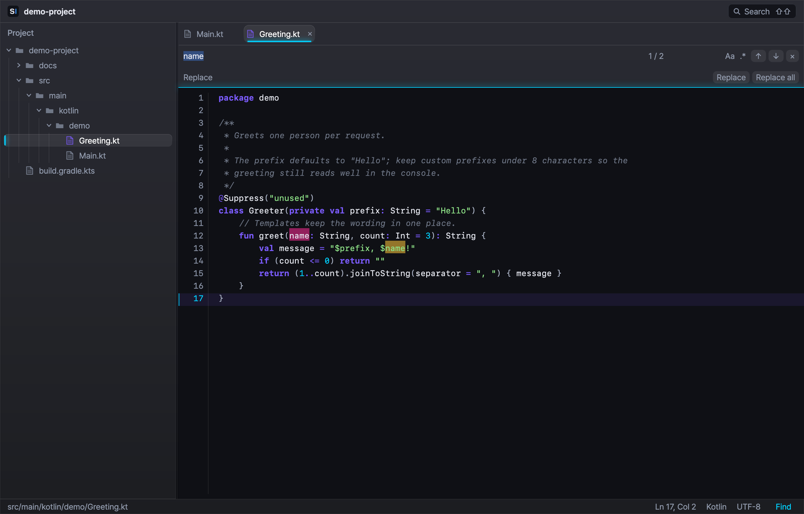</td>
<td valign="top">

- **Find bar** `⌘F` opens it below the top capsule row. `Enter`·`⌘G` moves to the next match and `⇧Enter`·`⌘⇧G` to the previous one, wrapping around at either end
- **Replace** `⌘R` expands the replace row. Replace the current match or all matches
- **Options** `Aa` matches case and `.*` uses a regular expression. In regular-expression replacements, `$1` refers to a group. An invalid expression shows an error
- **Display** the current match and the other matches are painted in different neon colors, with an `n / total` counter. `Esc` closes the bar and returns focus to the editor

</td>
</tr>
</table>

### Run

<table width="100%">
<tr>
<td width="44%" valign="top">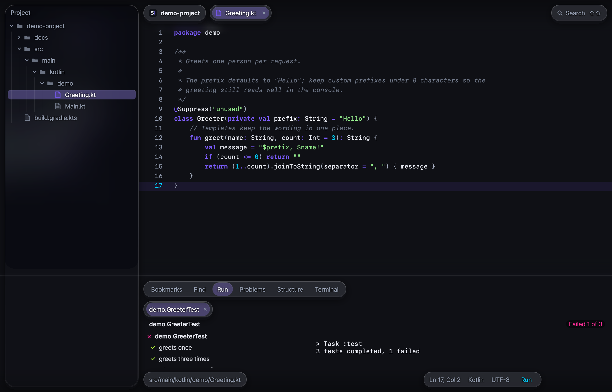</td>
<td valign="top">

- **Running tests** every class line and `@Test` function in a `.kt` file under `src/test` gets a `▶` in the gutter; click it to run that test. `⌃⇧R` runs the test at the caret, or the file's main or script when there is none
- **Running main** the `main` function in Kotlin and Java also gets a `▶` in the gutter. `⌃R` reruns the last run, otherwise it runs the same target as `⌃⇧R`. `.py`·`.sh`·`.js`·`.rb`·`.kts` scripts and a single-file Java source outside Gradle run directly; Kotlin and Java in a Gradle source set run through the `strideRunMain` task
- **Intentions, quick fixes, and run configurations** `⌥↩` opens a popup grouped into quick fixes, intentions, and run entries for the caret. In Kotlin it imports an unresolved symbol found in the project declaration index, removes unused imports from the import block, and switches `val` and `var`. The run group keeps the main and test runs at the caret plus rerun and stop, and the first entry is selected, so `Enter` applies a quick fix or intention when one is listed instead of running, and one `⌘Z` undoes an applied edit. `⌃⌥R` lists the current file's run entries and the 10 most recent runs, and `Enter` runs the selection. `⌘F9` builds `classes` and `testClasses`
- **Run window** when more than one session exists, or a session has finished, the window shows a tab per session with `×`. Test runs split into the test tree and console, count passed, failed, and skipped tests, and selecting a method shows its message, stack, and captured output. Application runs show the console only, with an input line at the bottom for standard input. `⌘F2` stops, `⌘R` reruns from the window, and `⌘4` opens it
- **Always runs** the Gradle init script disables up-to-date checks and the build cache for every `Test` task, so running the same test again still executes it and reports its events

</td>
</tr>
</table>

### Terminal

<table width="100%">
<tr>
<td width="44%" valign="top">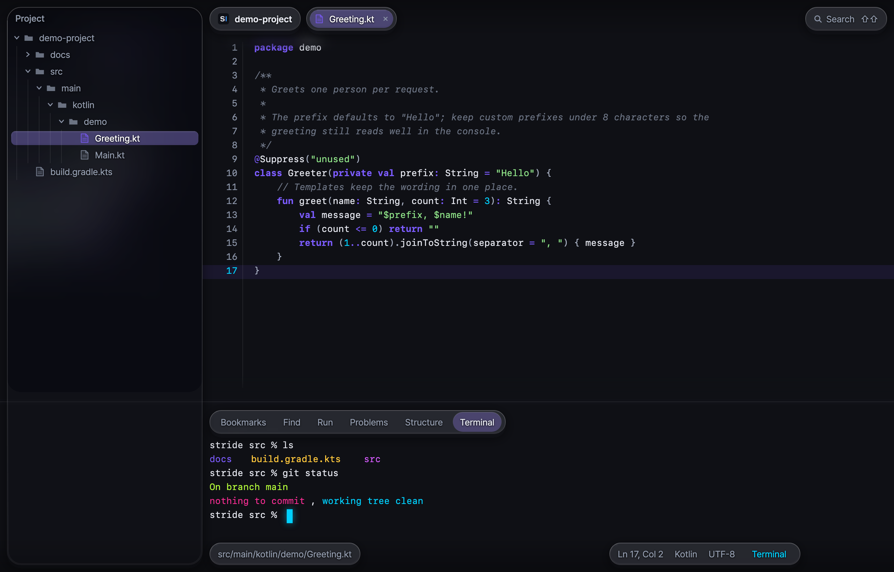</td>
<td valign="top">

- **Built-in terminal** `⌥F12` opens the Terminal window. It runs the login shell in the project directory over a real PTY (pty4j), and jediterm draws the screen
- **Neon ANSI palette** the 16 ANSI colors belong to the same neon family as the rest of the window. The cursor is `accent2`
- **Hide** `⇧Esc` hides the window and returns focus to where it was

</td>
</tr>
</table>

### Git

<table width="100%">
<tr>
<td width="44%" valign="top">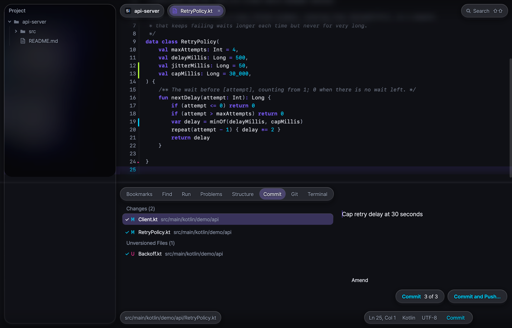<br><br>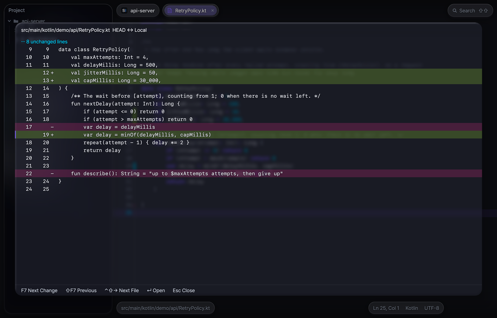</td>
<td valign="top">

- **Change marks** inside a Git repository, lines that differ from HEAD are marked at the right edge of the gutter. Added and changed lines get a colored bar and a deleted spot gets a small triangle; the comparison runs again 100 ms after typing stops, so unsaved edits show at once. Clicking a mark opens a popup with the HEAD lines and `Rollback ⌥⌘Z` and `Show Diff` buttons
- **Rollback and change navigation** `⌥⌘Z` returns the changes at the carets or in the selection to their HEAD lines, and one `⌘Z` undoes it. Nothing is saved. `⌃⌥⇧↓` / `⌃⌥⇧↑` move to the next / previous change
- **Commit** `⌘K` opens the Commit window with the message field focused. Changed and unversioned files are listed with checkboxes, and `⌘↩` commits only the checked ones. Unsaved editors of the checked files are saved first, and there is no separate staging area. In the window, `⌘D` opens the diff of the selected file
- **Push** `⇧⌘K` shows a confirmation popup with the current branch and the outgoing commits, and `↩` pushes. There is no force push and no tag push. A remote that needs credentials fails without a prompt, and the status bar says to retry in the terminal
- **Diff and the Git window** the diff shows HEAD and the current text in one column, and `F7` / `⇧F7` move between changes. In the `⌘9` Git window, the Log tab lists recent commits and `↩` opens a commit's diff; the Console tab shows the git commands stride ran and their output. `⌃V` is the VCS popup with these commands numbered

</td>
</tr>
</table>

### Liquid glass UI

<table width="100%">
<tr>
<td width="44%" valign="top"></td>
<td valign="top">

- **System glass** on macOS 26 or later the chrome is drawn by the system's own glass views behind the window content, so the desktop and other windows show through the sidebar, capsules, find bar, and popups. The editor, down to the gutter, and the tool window body with its console and terminal are glass too, so the desktop shows through everywhere
- **Legible code** on the native path code, gutter, console, and terminal colours stay at 4.5:1 over both light and dark desktops, including the darkest and the brightest surface where selection and find matches stack
- **Title bar** the title bar is hidden and the traffic lights sit in the top capsule row. Drag the empty part of that row to move the window, and double-clicking it follows the system title-bar setting
- **Light and dark** the window follows the system appearance live. The palette, syntax colours, and terminal colours each have a light and a dark set, so a change needs no restart. On the native path the window's appearance is set from the palette, so the system glass material and the text colours always follow the same appearance
- **Older macOS** on macOS versions before 26, or when the native library is missing, the previous in-window glass and the standard title bar are used
- **Background** on the path without native glass, a neutral graphite base with a soft top-to-bottom luminance falloff sits behind the window content. Color is reserved for emphasis
- **Glass on the fallback path** on the fallback path glass is used only for the sidebar, the top and bottom capsules, the find bar, popups, and the tool window switcher, and the editor and console are opaque rounded panels floating over it. On the native path the editor and the tool window body are glass too. On either path no bar or slab crosses the window
- **Floating glass sidebar** a rounded glass panel inset 10 dp from the top, left, and bottom edges. On the fallback path the real code right next to it is mirrored and blurred into a soft colour field under the panel, so the sidebar carries the tone of the code beside it, and outside the panel the pixels are the editor field. On the native path the panel itself shows the desktop through
- **Capsules instead of bars** the top row is split into a project name capsule, a tab capsule group, and a Search capsule; the bottom row into a file path capsule and a status capsule group. The selected tab is a glass pill that slides across the group, and that one pill marks the selection instantly. The status group carries `Ln`·`Col`, the file type, `UTF-8`, and the read-only badge. Each capsule frosts what is behind it so labels stay legible, and the gaps between capsules stay visible and clickable
- **Scroll edge effect** scrolled code softens under the top and bottom capsule rows and fades out toward the window edge. Instead of a bar covering and cutting it, the blur eases out gradually
- **Thin popups** on the fallback path, Search Everywhere, recent files, and the context actions popup float as thin glass over the code, showing it behind and bending it at the rim. A strong text shadow keeps labels legible, and they fall back to blur plus hairlines when the shader is unavailable. On the native path each popup is its own system glass piece floating above the surfaces it covers, with a palette plate under its labels so text keeps 4.5:1 over light and dark desktops alike
- **Popup shadow** on the native path each popup casts a soft system drop shadow that lifts it off the desktop, and the modal dimming over the window is much lighter
- **Welcome screen** without a project, the wordmark is the content, with an `Open Folder…` glass capsule and keycap hints below it
- **Selection signal** a selected tree row floats as a capsule with a small lens and shows one pill and white text. A focused tree panel draws a thin line around its border
- **Large files** documents of 1,000 lines or more scroll through a constant-cost layer, and the capsules use a cached frost fill; the layer is released once the document shrinks below 800 lines
- **Motion and cost** the selected tab's pill slides for 200 ms and nothing animates continuously. Capsule frost and the popup lens are computed on lower-resolution copies, and the background extension and scroll edge blur are cached so static frames do not compute them again
- **UI font** the bundled UI font can be swapped for the system font with `Switch UI Font` in the Actions tab. The choice is saved for the next launch

</td>
</tr>
</table>

<p align="center">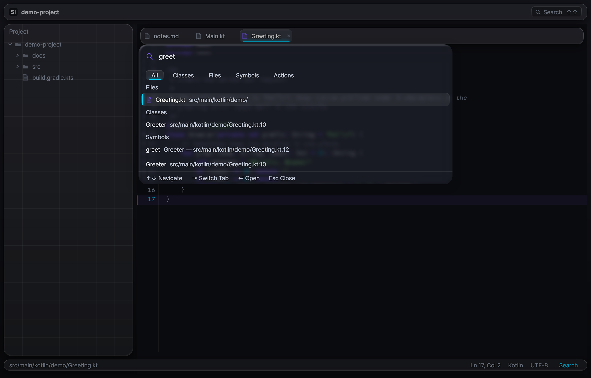</p>

<p align="center">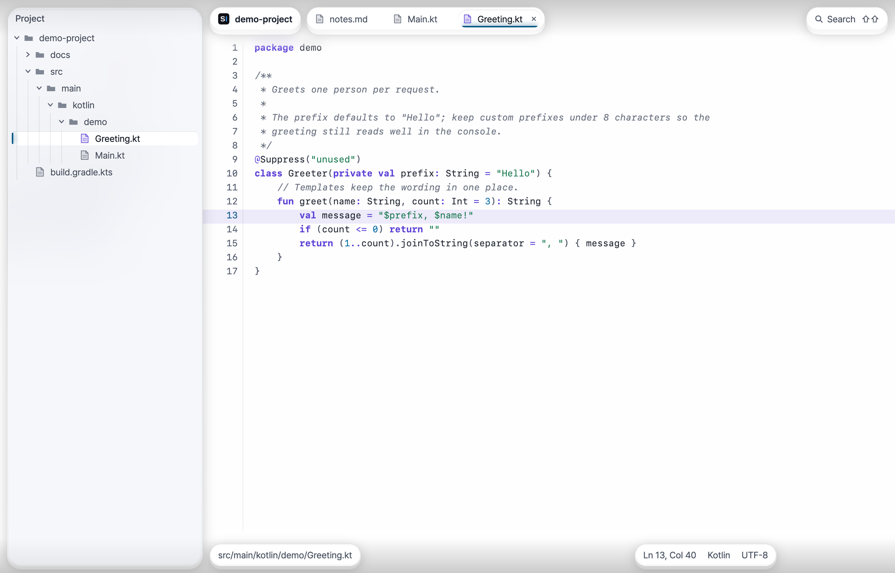</p>

<br>

## Usage

### Keyboard

These are the default keys. Shortcuts are compatible with the IntelliJ IDEA macOS default keymap; on non-macOS platforms Command and Control are swapped (`⌘S` becomes `Ctrl+S`, `⌃R` becomes `Meta+R`) and keys are shown with `Ctrl`, `Alt`, `Shift` and `Meta` labels. The full list and the context precedence are defined by the `bind(` calls in `app/src/main/kotlin/stride/app/keys/Keymap.kt`.

| Key | Action |
|---|---|
| **File and tabs** | |
| `⌘S` | Save |
| `⌘W` | Close tab |
| `⌘⇧]` `⌃→` / `⌘⇧[` `⌃←` | Next tab / previous tab |
| `⌘1` / `⌘⇧F12` | Toggle the project tree / hide and restore all tool windows |
| Actions tab | Reopen Closed Tab · Close Other Tabs |
| **Search and navigation** | |
| `⇧⇧` | Search Everywhere (All tab) |
| `⌘O` | Go to class. Opens the folder chooser when there is no project |
| `⌘⇧O` / `⌘⌥O` | Go to file / symbol |
| `⌘⇧A` | Go to action |
| `⌘⇧F` | Find in path (`⌘↵` in the popup opens the Find window) |
| `⌘E` / `⌃Tab` `⌃⇧Tab` | Recent files / recent-file switcher |
| `⌥F1` / `⌘⇧C` / `⌘⌥⇧C` | Reveal the current file in the tree / copy path / copy reference |
| **Editor** | |
| `⌘D` | Duplicate the line or selection |
| `⌘⌫` | Delete the line |
| `⌥⇧↑` / `⌥⇧↓` | Move the line up / down |
| `⌘/` · `⌘⌥/` | Toggle line comment · toggle block comment |
| `Tab` / `⇧Tab` | Indent / unindent |
| `⌘L` | Go to line |
| `Esc` | Close Go to Line, drop the secondary carets, clear usage highlights, collapse the selection to the caret |
| `⌘Z` / `⌘⇧Z` | Undo / redo |
| `⌥↑` / `⌥↓` | Grow / shrink the selection |
| `⌘⇧U` | Toggle case |
| `⌃⇧J` | Join lines |
| `⇧↩` / `⌘⌥↩` | Start a new line below / above |
| `⌃M` | Go to the matching brace |
| `⌘⌥[` / `⌘⌥]` | Go to the code block start / end |
| `⌃⇧↑` / `⌃⇧↓` | Move to the previous / next method |
| `⌥/` | Word completion |
| `⌃Space` · `⌃⌥Space` | Completion popup |
| `⌃⇧Space` | Completion narrowed by type or expression position |
| `⇧F6` | Rename in the file |
| `⌘C` / `⌘X` | Copy / cut the whole line when there is no selection |
| `⌘⇧V` | Paste from clipboard history |
| `⌘⇧↑` / `⌘⇧↓` | Move statement up / down |
| `⌘⇧↩` | Complete statement |
| `⌘⇧⌦` | Unwrap the enclosing block |
| `⌘⌥T` | Surround with a template |
| `⌘⌥L` | Reformat code |
| `⌃⌥O` | Optimize imports |
| `⌃L` | Scroll the caret line to the middle |
| `⌘P` | Parameter info |
| `F1` · `⌃J` / `⌥Space` | Declaration docs / declaration source |
| **Refactorings** | |
| `⌃T` | Refactor This (only what applies at the caret) |
| `⌥⌘V` | Introduce Variable |
| `⌥⌘M` | Extract Method |
| `⌥⌘N` | Inline |
| **Generate** | |
| `⌘N` / `⌃↩` | Generate (only what applies to the class at the caret) |
| `⌃O` | Override Methods |
| `⌃I` | Implement Methods |
| **Multiple carets** | |
| `⌃G` / `⌃⇧G` | Add the next match to the selection / drop the last added one |
| `⌃⌘G` | Select every match |
| `⌥⇧`-click | Add or remove a caret |
| `⌥⌥↑` / `⌥⌥↓` | Clone the caret above / below (holding the second `⌥`) |
| `⌥`-drag | Rectangular selection |
| `⌘⇧8` | Toggle column selection mode |
| **Code folding** | |
| `⌘=` / `⌘-` | Expand / Collapse (also numeric keypad `⌘+` / `⌘-`) |
| `⌘⇧=` / `⌘⇧-` | Expand All / Collapse All |
| **Find** | |
| `⌘F` | Open the find bar |
| `⌘R` | Expand the replace row |
| `⌘G` / `⌘⇧G` | Next match / previous match |
| `⌘⇧R` | Replace in path (`⌥⌘↵` replaces all, `⌘↵` previews in the Find window) |
| **Navigation** | |
| `⌘B` · `⌘`-click | Go to declaration |
| `⌘[` `⌘⌥←` / `⌘]` `⌘⌥→` | Back / forward |
| `⌘F12` | File structure |
| `⌘⇧T` | Go to test |
| `⌥F7` | Find usages (adds a Find window tab) |
| `⌘⌥F7` | Show usages popup (`⌘↵` opens it in the Find window) |
| `⌘⇧F7` | Highlight usages in file (`⌘G` / `⌘⇧G` move between them) |
| `⌘⇧E` | Recent locations |
| `⌘⇧⌫` | Last edit location |
| `⌥Home` · `⌘↑` (list window) | Navigation bar |
| `F4` · `⌘↓` (list window) | Edit source (declaration in the editor, the selected row in a list window) |
| `⌘2` / `⌘3` / `⌘6` / `⌘7` | Bookmarks / Find / Problems / Structure window |
| `F3` / `⌘F3` | Toggle bookmark / show bookmarks |
| `F2` / `⇧F2` | Next problem / previous problem |
| `⌘F1` | Describe the problem at the caret |
| `⌘⌥B` / `⌘U` | Go to implementation / super method |
| `⌘⇧B` `⌃⇧B` | Go to type declaration |
| `⌃H` / `⌃⌥H` | Type hierarchy / call hierarchy window |
| **Run** | |
| `⌥↩` | Context actions |
| `⌃⇧R` | Run the test at the caret, otherwise the file's main |
| `⌃R` | Rerun the last run, otherwise the test at the caret or the file's main |
| `⌃⌥R` | Choose a run configuration |
| `⌘F9` | Build |
| `⌘F2` | Stop the run |
| `⌘4` · `⌘R` (Run window) | Open the Run window · rerun from the Run window |
| **Terminal** | |
| `⌥F12` | Open the Terminal window |
| `⇧Esc` | Hide the tool window (Bookmarks, Find, Run, Problems, Structure, Terminal, Commit and Git windows) |
| **Git** | |
| `⌘K` | Open the Commit window (`⌘↩` commit, `Space` check a file, `⌘D` diff, `Tab` between the list and the message) |
| `⇧⌘K` | Push confirmation popup |
| `⌃V` | VCS popup (passed to the shell in the terminal) |
| `⌥⌘Z` | Rollback lines |
| `⌃⌥⇧↓` / `⌃⌥⇧↑` | Next change / previous change |
| `⌘0` / `⌘9` | Commit / Git window |
| `F7` / `⇧F7` · `⌃⇧→` / `⌃⇧←` (diff) | Next / previous change · next / previous file |
| **Other** | |
| Actions tab | Switch UI Font |

<br>

## Installation

### Homebrew

```sh
brew tap lcalmsky/stride https://github.com/lcalmsky/stride
brew trust lcalmsky/stride
brew install --cask lcalmsky/stride/stride
```

The repository is its own tap and the cask lives in `Casks/stride.rb`. The short name `stride` can collide with another tap, so install with the full `lcalmsky/stride/stride` name. `brew trust` marks a non-official tap as trusted so Homebrew may load its casks.

### Build from source

```sh
git clone https://github.com/lcalmsky/stride.git
cd stride
./gradlew :app:run                       # development run
./gradlew :app:createDistributable       # app/build/compose/binaries/main/app/strIDE.app
```

JDK 21 is required; the Gradle toolchain asks for 21.

### Requirements

| Requirement | Notes |
|---|---|
| macOS Apple Silicon (arm64) | The release app is arm64 only. The bundled runtime means no JDK installation is needed |
| macOS 26 or later (optional) | Needed for the system glass; below that the app draws its own glass in the window |
| Git (optional) | The Git features use the installed `git` command. Without it, Git actions report `Git is not installed` |
| JDK 21 | Needed only to build from source |
| Gatekeeper | When you download and unzip the app yourself, the first launch may show a warning. Right-click the app in Finder and choose `Open` |

<br>

## How it works

The app is split into six modules. `core` provides services, extension points, and `Disposer`; `lang` defines the language, file type, highlighter, commenter, intention, import optimizer, and problem provider APIs. `search` holds the file name index, the Kotlin and Java declaration index, and the Search Everywhere model, and `app` contains the Compose Desktop UI with the editor, navigation, bookmarks, Run window, and terminal. `plugins/lang-kotlin` and `plugins/lang-json` register the Kotlin and JSON lexers, highlighters, file types, and bracket-matching problem providers, and the Kotlin plugin also registers the import quick fixes, the `val`/`var` intention, the import optimizer, and the unused import warning.

Every module declares extension points and registers extensions through a `META-INF/stride-plugin.xml` descriptor. The app descriptor opens the file type, syntax highlighter, commenter, intention, import optimizer, problem provider, refactoring provider, generate provider, editor, tree structure, and Search Everywhere contributor extension points, and the language plugins and the app itself register into them. Class and symbol search register as contributors over the declaration index, and the app assembles action search directly. The declaration index also reads supertypes, imports and member ranges, from which the hierarchy actions build a type graph. The Git features belong to the project service `GitService`, which runs the `git` command as a child process. It reads status with `git status --porcelain=v2`, and the gutter marks come from an in-process line diff of the file at HEAD against the editor text. The full contracts are in [core](docs/api-core.md) · [lang](docs/api-lang.md) · [search](docs/api-search.md) · [app](docs/api-app.md).

The editor keeps its scroll viewport and chrome insets separate: content runs to the window edge while the glass capsules and the sidebar float over it, and the insets feed caret scrolling, the gutter, and scrollbar padding. Documents of 1,000 lines or more place their content in a separate scroll layer and drop back below 800 lines.

On the native path a JNI library places system glass views behind the window content and Compose only reports the pieces above them. When the library is missing or macOS is older than 26, the same piece reports are drawn with Skia materials instead.

<br>

## Development

```sh
./gradlew test                    # tests; must report zero failures
./gradlew :app:createDistributable
./gradlew :app:run                # opens a window, so run it yourself
```

- The tests number about 580 and take roughly two minutes. `UiSnapshotTest` writes screen PNGs to `app/build/ui-snapshots/`
- `:app:buildNativeGlass` runs only when `clang++` (Xcode Command Line Tools) is available; otherwise it logs one line and the app uses the Skia glass path. Pass `-Pstride.nativeGlass=false` to skip the native build
- Release with `scripts/release.sh X.Y.Z -m "<summary of changed features>"`. `scripts/release-selftest.sh` checks that script
- Repository rules are in [CLAUDE.md](CLAUDE.md)

<br>

<p align="center"><a href="LICENSE">MIT</a></p>
