<h1 align="center">strIDE</h1>

<p align="center">키보드로 다루는 macOS 코드 에디터.</p>

<p align="center"><b>한국어</b> · <a href="README.en.md">English</a></p>

<p align="center">
  <a href="https://github.com/lcalmsky/stride/releases/latest"></a>
  
  <a href="LICENSE"></a>
</p>

<p align="center">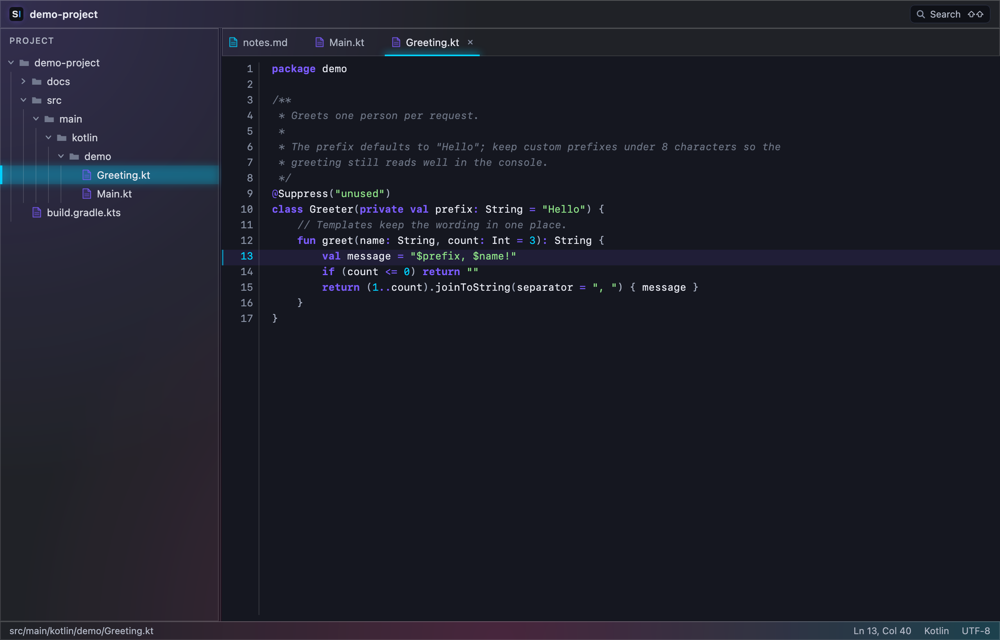</p>

<p align="center">
  프로젝트 트리 &nbsp;·&nbsp; 탭 에디터 &nbsp;·&nbsp; Kotlin·JSON 문법 하이라이트 &nbsp;·&nbsp; 찾기와 바꾸기 &nbsp;·&nbsp; 리퀴드 글래스 UI<br>
  Kotlin 과 Compose Desktop 으로 만든 Apple Silicon 전용 앱입니다.
</p>

<br>

## 빠른 시작

```sh
brew tap lcalmsky/stride https://github.com/lcalmsky/stride
brew trust lcalmsky/stride
brew install --cask lcalmsky/stride/stride
```

앱은 `/Applications/strIDE.app` 에 설치됩니다. Apple Silicon(arm64) 전용이고, 번들 런타임이 들어 있어 JDK 를 따로 설치하지 않아도 됩니다.

<br>

## 기능

### 에디터

<table width="100%">
<tr>
<td width="44%" valign="top"><br><br>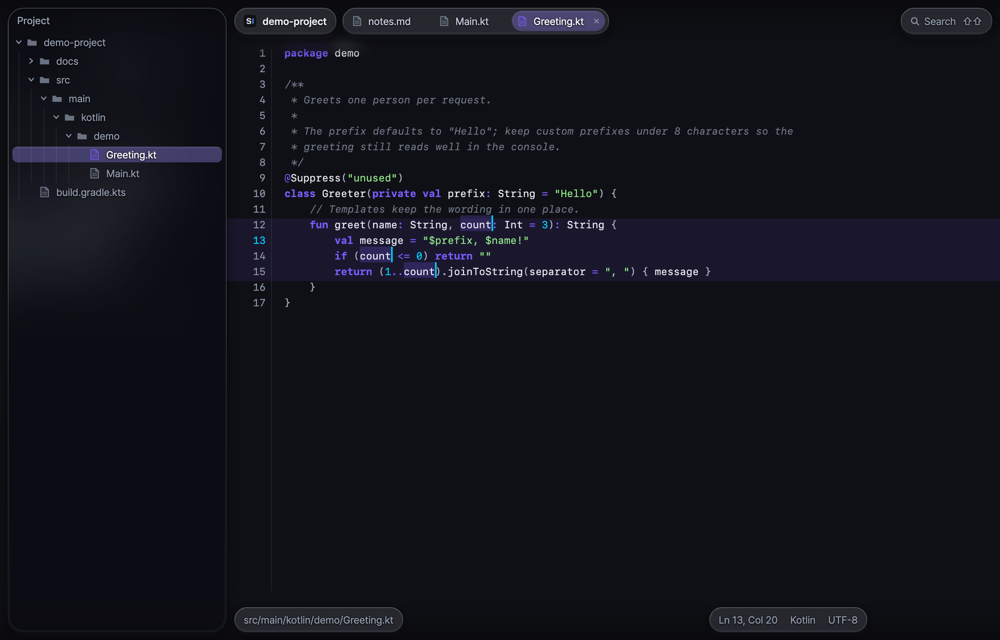<br><br>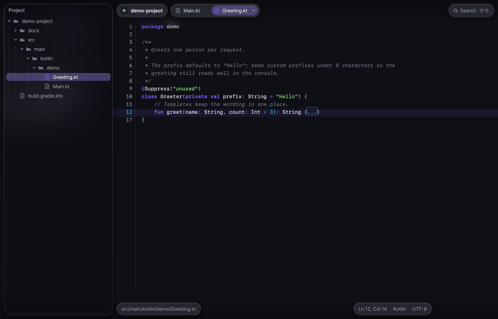<br><br>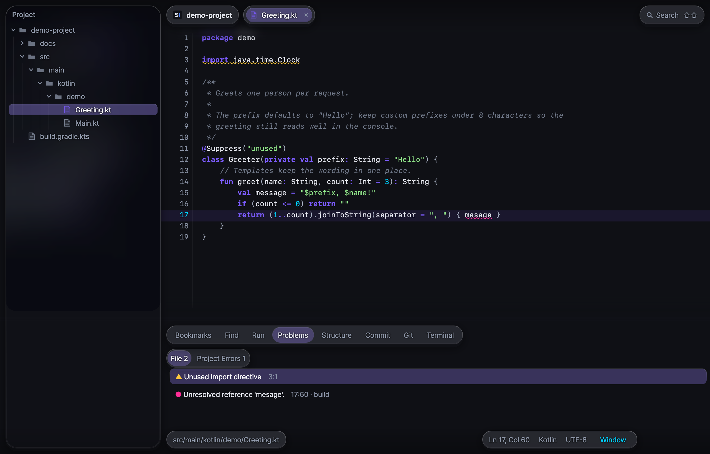<br><br>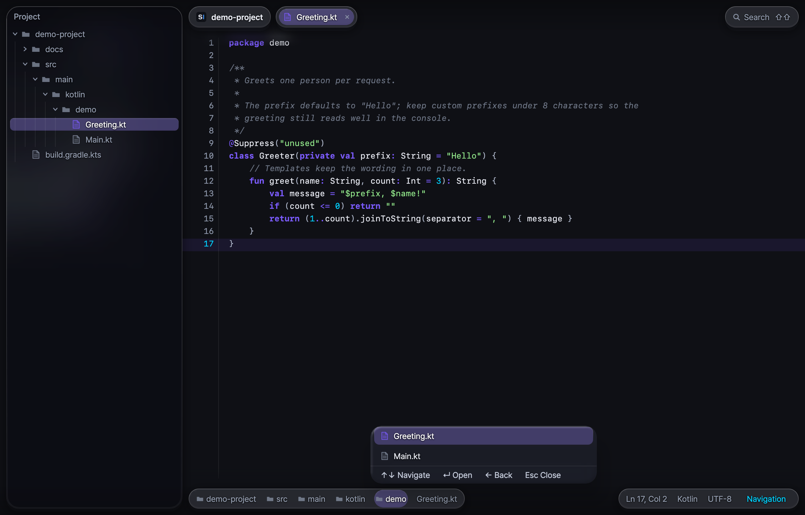<br><br>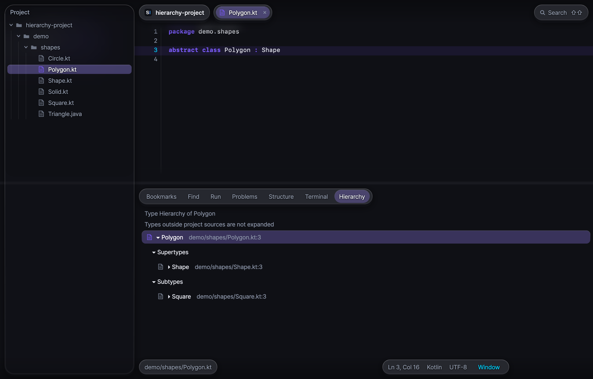<br><br>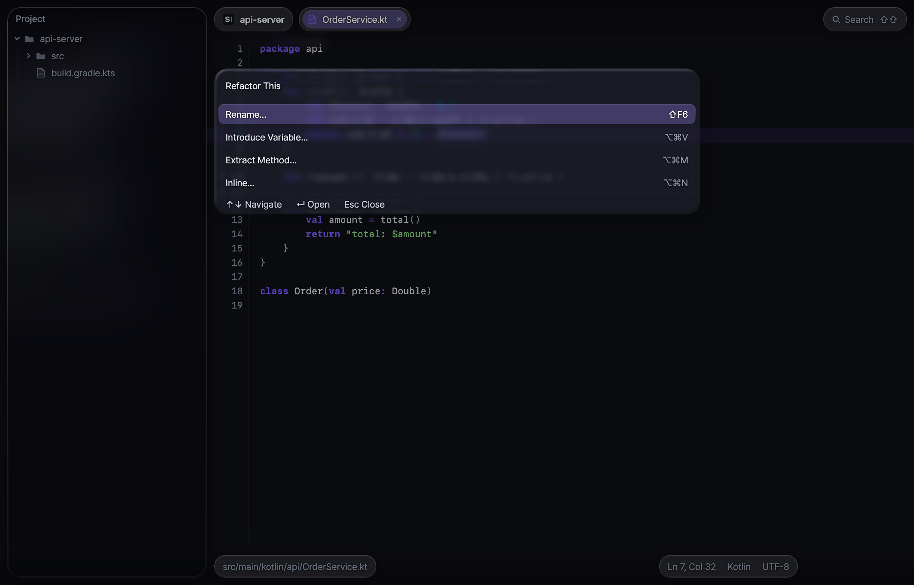<br><br>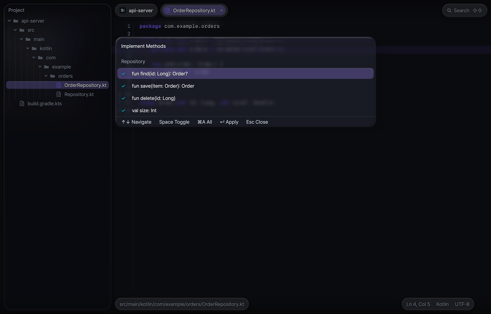 의 멤버를 고르는 Implement Methods 팝업" width="480"><br><br>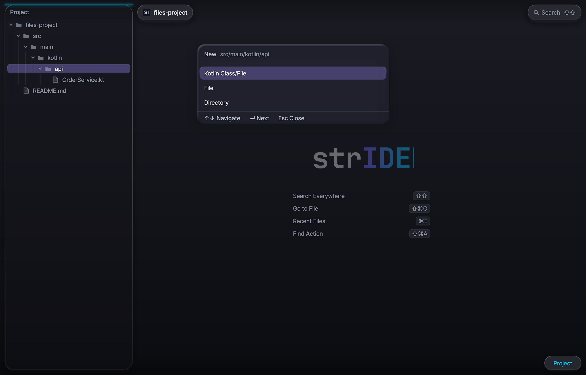<br><br>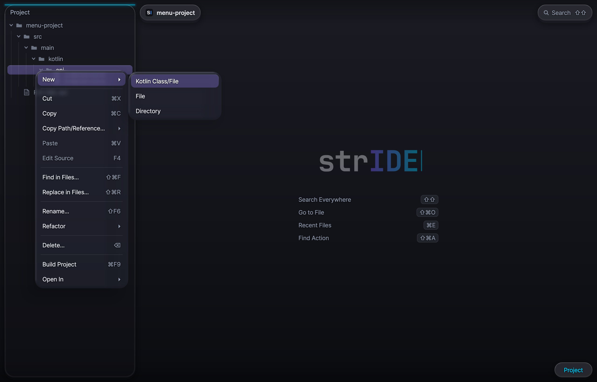</td>
<td valign="top">

- **프로젝트 트리** 폴더는 한 번 클릭에 펼치고 파일은 한 번 클릭에 엽니다. `.git`, `build`, `.gradle`, `node_modules`, `.kotlin`, `.idea` 는 숨깁니다. 경계를 끌어 너비를 200–480 dp 사이에서 바꾸고, `⌘1` 은 IntelliJ 처럼 트리에 키보드를 주고 키보드를 가진 트리를 한 번 더 누르면 닫으며, `⌥F1` 로 현재 파일을 트리에서 드러냅니다. 트리에 키보드가 있으면 `↑`·`↓` 로 행을 고르고 `→`·`←` 로 폴더를 펼치거나 접으며, `↵`·`F4` 로 파일을 열고 `Esc` 로 에디터에 돌아갑니다
- **파일 작업** 트리에서 `⌘N`(또는 `⌃↩`) 으로 Kotlin Class/File, File, Directory 를 만듭니다. Kotlin 클래스는 Class·File·Interface·Data class·Enum class·Object 중에서 고르고, `src/main/kotlin` 아래라면 경로대로 `package` 줄을 적습니다. `⇧F6` 은 이름 바꾸기, `F6` 은 이동, `F5` 는 복사, `⌫` 는 확인 뒤 휴지통으로 옮기기이고, `⌘X`·`⌘C`·`⌘V` 로 파일을 잘라 내거나 복사해 붙입니다. 이름을 바꾸거나 옮긴 파일의 탭은 저장하지 않은 편집을 그대로 가진 채 새 경로를 따라가고, 지운 파일의 탭은 닫힙니다. 파일 작업은 git 명령 없이 디스크에서 하므로 Commit 창에는 삭제와 새 파일로 보이다가 함께 커밋하면 이름 바꾸기로 기록됩니다. 프로젝트 루트는 바꿀 수 없고, 링크를 거쳐 프로젝트 밖에 쓰는 작업은 거부합니다. Reveal in Finder 와 Open in Terminal 은 Actions 탭이나 우클릭 메뉴의 `Open In` 에서 엽니다. 트리의 `⇧⌘C` 는 고른 트리 항목의 프로젝트 상대 경로를 복사합니다
- **탭 에디터** 연 파일이 탭으로 열리고, 같은 파일을 다시 열면 그 탭을 고릅니다. 탭은 `⌘W` 로 닫고 `⌘⇧]`·`⌃→` 와 `⌘⇧[`·`⌃←` 로 오갑니다. 닫은 탭과 나머지 탭은 Actions 탭이나 탭 우클릭 메뉴의 `Reopen Closed Tab`·`Close Other Tabs` 로 다룹니다. 터미널의 git 이나 다른 프로그램이 파일을 바꾸면 저장하지 않은 편집이 없는 탭은 디스크 내용을 다시 읽고(`⌘Z` 로 이전 글로 돌아갑니다), 저장하지 않은 편집이 있는 탭은 그대로 둡니다
- **우클릭 메뉴** 에디터 본문·프로젝트 트리·에디터 탭·거터를 우클릭하거나 `⌃`-클릭하면 IntelliJ 와 같은 순서의 메뉴가 포인터 자리에 뜹니다. 우클릭한 행이나 탭을 먼저 고르고, 에디터에서는 선택 밖을 우클릭하면 캐럿이 그 자리로 옮겨지며 선택 안을 우클릭하면 선택이 그대로입니다. 메뉴 행은 그 자리에서 단축키를 누른 것과 같은 일을 하고 오른쪽에 그 자리에서 듣는 단축키를 보여 주며, 할 수 없는 행은 흐리게 보입니다. `↑`·`↓` 로 고르고 `→`·`←` 로 하위 메뉴를 열고 닫으며 `↩` 로 실행하고 `Esc` 로 닫습니다. 트리 메뉴의 New 하위 메뉴는 Kotlin Class/File·File·Directory 의 이름 입력을 바로 열고, 탭 메뉴에는 Close All Tabs·Close Tabs to the Left·Close Tabs to the Right 가 있습니다. 에디터의 Cut·Copy·Paste 는 `⌘X`·`⌘C`·`⌘V` 와 같은 결과를 냅니다
- **문법 하이라이트** Kotlin 플러그인과 JSON 플러그인이 각각 렉서와 하이라이터를 제공합니다. 2 MB 를 넘는 파일은 하이라이트 없이 읽기 전용으로 엽니다
- **편집** 줄 복제·삭제·이동, 줄·블록 주석 토글, 들여쓰기, 실행 취소·다시 실행을 키보드로 합니다. `⌘L` 로 `줄` 이나 `줄:열` 로 이동합니다. 선택 없이 `⌘C`·`⌘X` 를 누르면 줄 전체를 복사·잘라내고, `⌘⇧V` 는 최근에 복사한 텍스트 20개 중에서 골라 붙여 넣습니다
- **문장 편집** `⌘⇧↑`·`⌘⇧↓` 는 블록과 위에 붙은 주석·애너테이션까지 묶은 문장을 같은 블록 안의 이웃 문장과 맞바꿉니다. `⌘⇧↩` 는 닫히지 않은 괄호를 닫고 `if`·`fun` 같은 줄에 블록을 열어 문장을 마무리하고, `⌘⇧⌦` 는 커서를 감싼 `if`·`else`·`for`·`while`·`do`·`try` 를 풀어 본문만 남깁니다. `⌘⌥T` 는 선택한 줄을 `if`·`try / catch` 같은 템플릿으로 감쌉니다(Kotlin·Java)
- **코드 정리** `⌘⌥L` 은 괄호 깊이로 들여쓰기를 다시 맞추고 줄 끝 공백과 연속 빈 줄을 정리합니다(Kotlin·Java·JSON, 그 밖의 파일은 공백만). 줄바꿈 위치는 바꾸지 않습니다. `⌃⌥O` 는 Kotlin 파일의 안 쓰는 import 와 중복을 지우고 IntelliJ 기본 순서로 정렬합니다. `⌃L` 은 커서 줄을 화면 가운데로 스크롤합니다
- **코드 정보** `⌘P` 는 커서가 있는 호출의 파라미터 목록을 현재 파라미터를 강조해 보여 주고, 입력을 계속 받으면서 커서를 따라 갱신합니다. `F1`·`⌃J` 는 선언 위의 KDoc·주석을, `⌥Space` 는 선언 원문을 팝업으로 보여 줍니다. 선언은 현재 파일과 선언 인덱스에서 찾습니다
- **편집 도우미** `⌥↑`·`⌥↓` 는 커서에서 단어·문자열·괄호·줄 순으로 선택을 넓히고 좁힙니다. `⌘⇧U` 대소문자, `⌃⇧J` 줄 합치기, `⇧↩`·`⌘⌥↩` 새 줄, `⌃M` 짝 괄호, `⌘⌥[`·`⌘⌥]` 코드 블록, `⌃⇧↑`·`⌃⇧↓` 메서드 이동을 키보드로 합니다. `⌥/` 는 열린 편집기의 단어로, `⌃Space`·`⌃⌥Space` 는 선언 인덱스와 키워드로 자동 완성하고, `⌃⇧Space` 는 타입 자리면 클래스, 식 자리면 심볼만 후보로 거릅니다. `⇧F6` 은 파일 안에서 이름을 바꿉니다
- **리팩터링** `⌃T` 는 커서 위치에서 적용할 수 있는 것만 `Rename…`·`Introduce Variable…`·`Extract Method…`·`Inline…` 으로 단축키와 함께 보여 줍니다. `⌥⌘V` 는 변수를 도입하는데, 선택이 없으면 후보 식 중에서 고르게 하고 같은 식의 다른 출현까지 함께 바꿀지 정합니다. `⌥⌘M` 은 선택한 문장이나 식을 `private fun` 으로 빼내며 입력과 출력을 스스로 판정하고, `⌥⌘N` 은 지역 `val` 과 같은 파일의 함수를 인라인합니다(Kotlin 파일만). 컴파일러가 없으므로 결과가 원래 코드와 같은 뜻임을 글로 증명할 수 있을 때만 실행하고, 아니면 조건에 따라 도는 식, 타입을 모르는 입력, 타입 검사로 좁혀진 변수, 수신자가 바뀌는 람다 안처럼 이유를 상태 줄에 한 줄로 알린 뒤 아무것도 바꾸지 않습니다. 적용한 변경은 실행 취소 한 번으로 되돌립니다
- **생성** `⌘N`(또는 `⌃↩`)은 커서가 놓인 클래스에 만들 수 있는 것만 `Secondary Constructor…`·`equals() and hashCode()…`·`toString()…`·`Override Methods…`·`Implement Methods…` 로 보여 주고, `⌃O`·`⌃I` 는 덮어쓸 멤버와 구현할 멤버를 바로 고르게 합니다. 멤버 선택 창에서 `Space` 로 체크하고 `⌘A` 로 모두 고른 뒤 `↵` 로 넣습니다. 상위 타입은 프로젝트 소스에서 읽어 `Repository<Order>` 의 `save(item: T)` 를 `save(item: Order)` 로 바꿔 쓰고 필요한 import 를 더하며, 구체 멤버는 `super` 호출(vararg 는 `*xs`, 상위 타입이 둘이면 `super<A>`)로, 추상 멤버는 `TODO("Not yet implemented")` 로 채웁니다. 새 생성자가 기존 `A(1)` 호출의 대상을 바꿀 수 있거나(기본값·vararg 생성자, companion `invoke`, 같은 이름의 최상위 함수) 라이브러리 클래스가 이미 구현했을 수 있는 멤버처럼 결과가 조용히 달라질 수 있으면 이유를 상태 줄에 알리고 아무것도 넣지 않습니다(Kotlin 파일만, 라이브러리 상위 타입의 멤버는 목록에 없음). 생성은 실행 취소 한 번으로 되돌립니다
- **멀티 캐럿** `⌃G` 는 다음 일치를 선택에 더하고(선택이 없으면 커서 단어를 고름) `⌃⇧G` 는 마지막에 더한 것을 빼며 `⌃⌘G` 는 모든 일치를 고릅니다. `⌥⇧`-클릭이나 `⌥` 를 두 번 누른 채 `↑`·`↓` 로 캐럿을 더하고, `⌥`-드래그나 `⌘⇧8` 열 선택 모드로 사각 선택을 만듭니다. 입력·삭제·붙여넣기·화살표 이동과 줄 주석·복제·삭제·들여쓰기·대소문자는 모든 캐럿에 적용되고, 그 밖의 액션은 보조 캐럿을 지우고 주 캐럿에서만 동작합니다. `Esc` 로 보조 캐럿을 지웁니다
- **코드 접기** `⌘-` 는 커서 줄에서 시작하거나 커서를 감싼 블록을 `{...}` 로 접고 `⌘=` 는 다시 펼칩니다. `⌘⇧-`·`⌘⇧=` 는 파일의 모든 블록을 접고 펼치며, 숫자패드 `⌘+`·`⌘-` 도 같습니다. 여러 줄에 걸친 `{}`·`[]` 블록, 블록 주석과 KDoc, import 목록을 접을 수 있습니다(Kotlin·Java·JSON). `←`·`→` 는 접힌 영역을 건너뛰고, 자리표시를 클릭하거나 줄로 이동·찾기·탐색으로 커서가 접힌 곳에 들어가면 펼쳐집니다. 접힌 줄의 번호는 거터에서 빠지고, 접거나 펼 블록이 없으면 상태 표시줄에 그렇다고 알립니다
- **탐색** `⌘B` 나 `⌘`-클릭으로 선언으로 가고, `⌘[`·`⌘]` 또는 `⌘⌥←`·`⌘⌥→` 로 뒤로·앞으로 갑니다. `⌘F12` 파일 구조, `⌘⇧T` 테스트로 이동을 하고, `⌥F7` 은 사용처를 Find 창의 `Usages of` 탭으로 열며 `⌘2` 북마크 창과 `⌘7` 구조 창이 북마크와 선언을 나열합니다. `F3`·`⌘F3` 로 북마크를 다룹니다. `⌘⇧F7` 은 현재 파일에서 커서 단어의 사용처를 강조하고, 강조가 있는 동안 `⌘G`·`⌘⇧G` 로 사용처를 오가며 `Esc` 나 편집으로 지웁니다. `⌘⇧⌫` 는 마지막으로 고친 자리로 가고, 거듭 누르면 그 전에 고친 자리로 갑니다(파일을 넘나들며 최근 50곳). `F4` 는 커서 위치의 선언으로 가고, 목록 창에서는 `F4`·`⌘↓` 가 고른 항목을 열어 키보드를 에디터로 넘깁니다. Find·Problems·Bookmarks·Structure·Hierarchy 목록 창의 행을 우클릭하면 그 행을 여는 `Jump to Source` 가 뜨고, Problems 에는 `Show Quick-Fixes` 도 있습니다
- **계층 탐색** `⌘⌥B` 는 인터페이스·추상 클래스와 그 멤버의 구현을 프로젝트 소스에서 찾아 하나면 바로 열고 여럿이면 후보 목록을 띄웁니다. `⌘U` 는 상위 메서드로 이동하며, 클래스 안에서는 그 클래스의 상위 클래스·인터페이스로 갑니다. `⌘⇧B`·`⌃⇧B` 는 타입 선언으로 이동하는데, 타입을 텍스트에 적었거나 생성자 호출로 초기화한 경우만 따라가고 추론이 필요하면 그 이유를 상태 줄에 알립니다. `⌃H` 는 Hierarchy 창에 상위·하위 타입 트리를, `⌃⌥H` 는 호출자·피호출자 트리를 엽니다. 노드의 하위 항목은 펼칠 때 찾고 `←`·`→` 로 접고 펼칩니다. 호출 관계는 컴파일러 없이 이름과 가시성으로 맞추므로 같은 이름의 다른 선언이 섞일 수 있고, 창 머리에 그 사실을 적습니다. 프로젝트 밖(라이브러리) 타입은 펼치지 않습니다. 저장하지 않은 편집도 반영해 열린 에디터의 글을 기준으로 상위 타입과 위치를 찾습니다. 호출이나 타입 이름이 여러 선언으로 풀리면 첫 후보를 고르지 않고 후보마다 루트를 둔 트리를 엽니다
- **탐색 막대** `⌥Home`(목록 창에서는 `⌘↑`도)을 누르면 하단 경로 캡슐이 프로젝트·폴더·파일 조각으로 나뉩니다. `←`·`→` 로 조각을 고르고 `↓`·`Enter` 로 그 폴더의 하위 항목을 캡슐 위 목록으로 엽니다. 목록에서 파일을 고르면 열고, 폴더를 고르면 한 단계 들어가며, `Esc` 로 닫습니다. 에디터 안의 `⌘↑`·`⌘↓` 는 문서 처음·끝 이동으로 남아 있습니다
- **문제 표시** 컴파일러 없이 텍스트만으로 판정한 문제와 마지막 Gradle 실행의 컴파일러 메시지를 함께 보여 줍니다. Kotlin·JSON 은 짝이 맞지 않는 괄호를 오류로, Kotlin 의 안 쓰는 import 를 경고로 표시하며, 입력이 300 ms 멈추면 다시 계산합니다. 오류는 분홍, 경고는 노랑 물결 밑줄로 그립니다. `F2`·`⇧F2` 는 현재 파일의 다음·이전 문제로 가고(오류가 있으면 오류만 돌고 끝에서 반대쪽 끝으로 감김), `⌘F1` 은 커서 위치 문제의 설명을 팝업으로 보여 줍니다. `⌘6` Problems 창은 현재 파일의 문제(File)와 프로젝트의 오류(Project Errors)를 탭으로 나누고, 창에 키보드가 있으면 `⌘⇧]`·`⌘⇧[` 로 탭을 바꿉니다. 빌드 메시지는 그 뒤에 파일을 고쳐도 줄을 확실히 맞출 수 있을 때만 표시합니다
- **상태 캡슐** 하단의 경로 캡슐은 상대 경로를, 상태 캡슐 그룹은 `Ln`·`Col`, 파일 종류, `UTF-8`, 읽기 전용 표시를 보여 줍니다. 프로젝트가 Git 저장소 안에 있으면 상태 캡슐 그룹 맨 앞에 현재 브랜치 이름(detached HEAD 면 짧은 커밋 id)이 보이고, 누르면 브랜치 팝업이 열립니다

</td>
</tr>
</table>

### 검색

<table width="100%">
<tr>
<td width="44%" valign="top">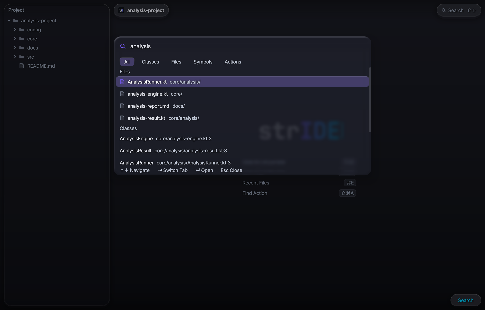<br><br>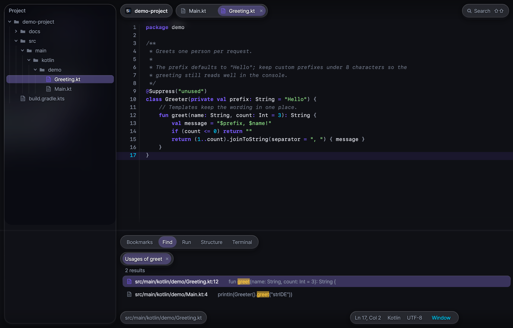<br><br>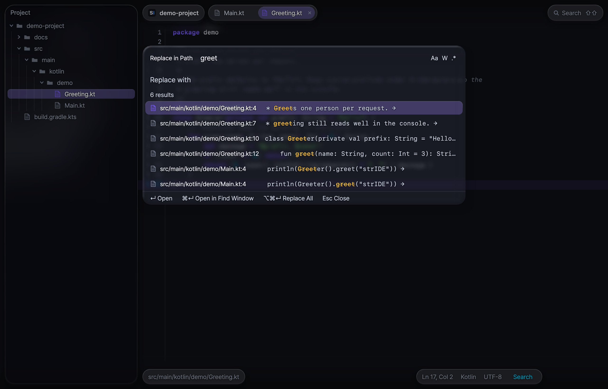<br><br>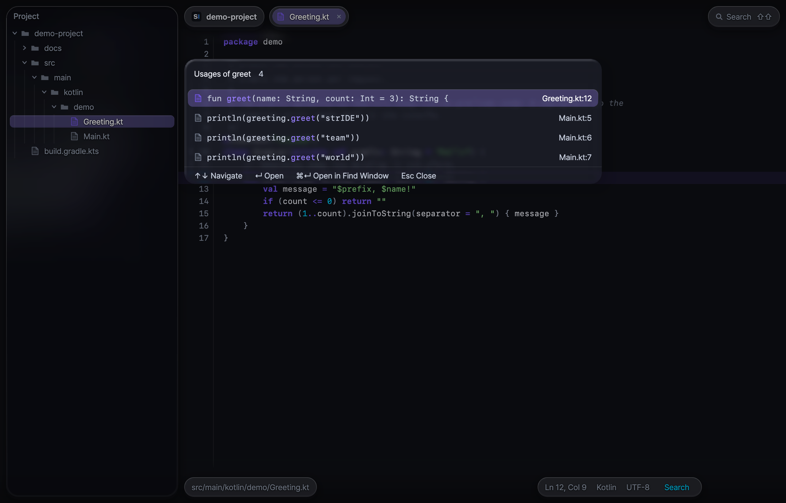<br><br>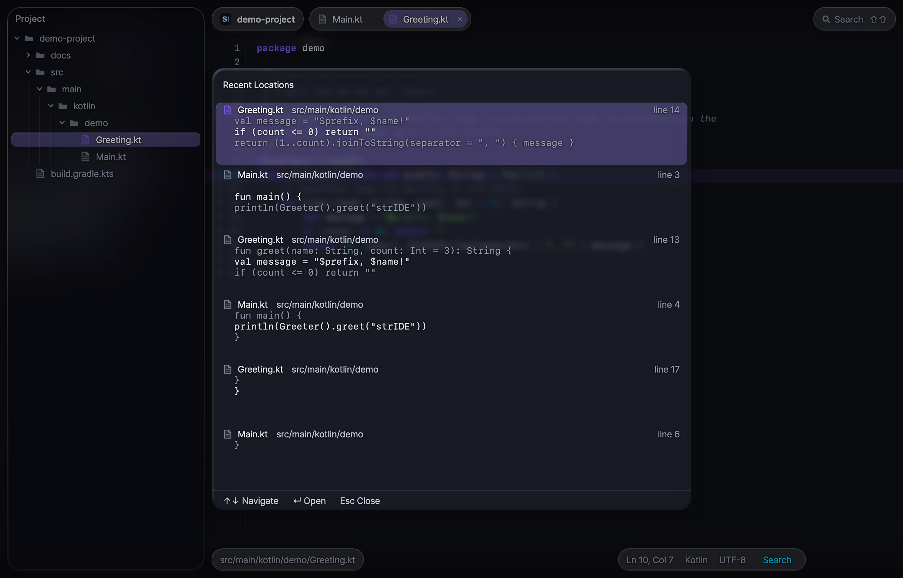</td>
<td valign="top">

- **Search Everywhere** `Shift` 를 두 번 누르면 All 탭으로 열립니다. 파일·클래스·심볼·액션 결과를 묶어 보여 주고(`Files`·`Classes` 같은 그룹, 기여자별 4개·전체 50개까지), `Tab`·`⇧Tab` 으로 All·Classes·Files·Symbols·Actions 탭을 오갑니다. `↑`·`↓` 로 옮기고 `Enter` 로 엽니다
- **클래스·심볼** `⌘O` 는 클래스, `⌘⌥O` 는 심볼 검색을 엽니다. 백그라운드 선언 인덱스가 Kotlin·Java 의 클래스·함수·프로퍼티를 훑어 클래스는 `경로:줄`, 심볼은 `컨테이너 — 경로:줄` 을 보여 주고 `Enter` 로 그 줄을 엽니다
- **파일로 이동** `⌘⇧O` 는 파일 이름과 상대 경로를 퍼지 매칭해 점수 순으로 보여 줍니다
- **액션** `⌘⇧A` 는 모든 액션을 이름과 단축키로 보여 주고 `Enter` 로 실행합니다
- **프로젝트 텍스트 검색** `⌘⇧F` 는 프로젝트의 파일에서 글자를 찾습니다. 2 MB 가 넘는 파일과 바이너리 파일은 건너뛰고 최대 200건을 보여 줍니다. `W` 는 단어 단위 일치를 켭니다. 결과는 `경로:줄` 과 줄 내용으로 나오고 일치한 글자는 강조됩니다. `Enter` 로 파일을 열고 그 위치를 선택합니다
- **Find 창** `⌘3` 으로 결과 창을 엽니다. `⌥F7` 사용처 찾기와 `⌘⇧F` 팝업의 `⌘↵` 가 결과 탭을 만들고, 탭은 최대 10개까지 남습니다. 결과는 파일로 묶지 않고 `경로:줄` 과 줄 내용으로 보여 주며 `↑`·`↓` 로 옮기고 `Enter` 로 열고, `⌘W` 는 Find 창에 포커스가 있을 때 편집기 탭 대신 선택한 결과 탭을 닫습니다
- **사용처 팝업** `⌘⌥F7` 은 `⌥F7` 과 같은 검색(단어 단위·대소문자 구분)을 팝업으로 보여 줍니다. 결과는 최대 200건이고 행마다 일치한 글자를 강조한 줄과 `파일:줄` 을 보여 줍니다. `Enter` 로 열고, `⌘↵` 는 `⌥F7` 과 같은 Find 창 탭으로 넘깁니다
- **Replace in Path** `⇧⌘R` 로 프로젝트 전체의 글자를 바꿉니다. 결과 행은 지워지는 글자와 바뀔 글자를 함께 보여 주고, `⌥⌘↵` 는 확인 줄을 거쳐 전체를 바꾸며 `⌘↵` 는 바꾸기 미리보기를 Find 창 탭으로 엽니다. 열린 편집기의 파일은 저장하지 않은 채로 고치고 파일마다 `⌘Z` 한 번으로 되돌리며, 디스크에 쓰는 파일은 되돌릴 수 없어 확인 줄이 그 수를 알립니다. UTF-8 이 아닌 파일은 건너뜁니다
- **최근 파일** `⌘E` 는 최근에 연 파일을 최신 순으로 최대 50개 보여 줍니다. 닫은 파일도 목록에 남습니다
- **최근 위치** `⌘⇧E` 는 이동 기록의 자리를 최신 순으로 보여 주고, 자리마다 그 줄과 앞뒤 한 줄씩 코드 세 줄을 함께 보여 줍니다. 같은 파일의 같은 줄은 한 번만 나오고 지금 커서가 있는 줄은 빠집니다. 열린 파일은 저장하지 않은 글을 읽습니다

</td>
</tr>
</table>

### 찾기

<table width="100%">
<tr>
<td width="44%" valign="top">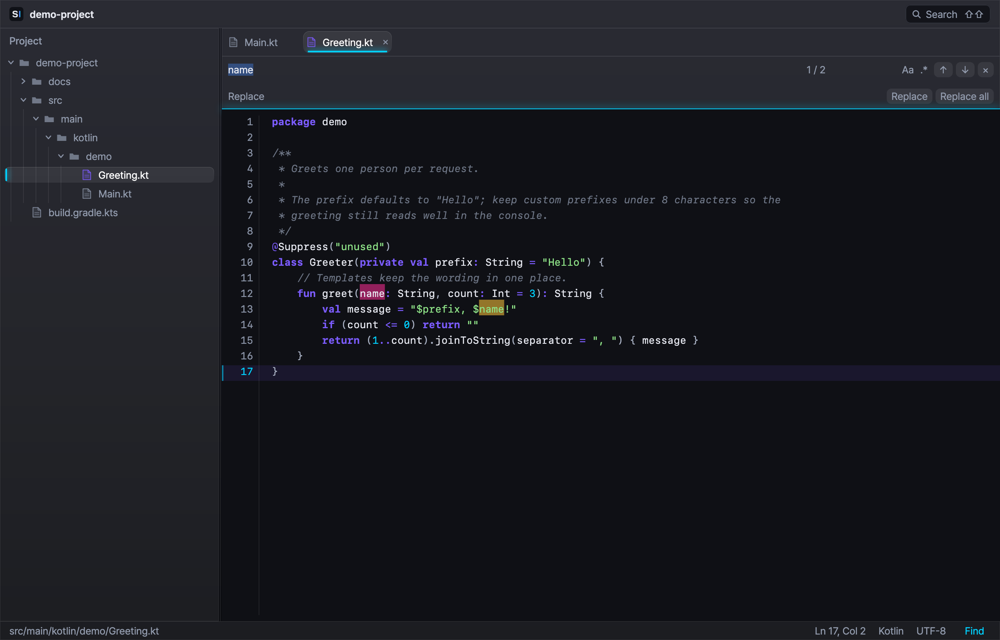</td>
<td valign="top">

- **찾기 바** `⌘F` 로 상단 캡슐 줄 아래에 엽니다. `Enter`·`⌘G` 는 다음 일치로, `⇧Enter`·`⌘⇧G` 는 이전 일치로 이동하고 끝에서 반대편으로 돌아갑니다
- **바꾸기** `⌘R` 로 바꾸기 줄을 펼칩니다. 현재 일치나 전체를 바꿉니다
- **옵션** `Aa` 는 대소문자를 구분하고 `.*` 는 정규식을 씁니다. 정규식 바꾸기에서는 `$1` 로 그룹을 참조합니다. 잘못된 정규식은 오류를 보여 줍니다
- **표시** 현재 일치와 나머지 일치를 서로 다른 네온 색으로 칠하고 `n / 전체` 카운터를 보여 줍니다. `Esc` 로 닫고 에디터로 포커스를 돌려줍니다

</td>
</tr>
</table>

### Run

<table width="100%">
<tr>
<td width="44%" valign="top">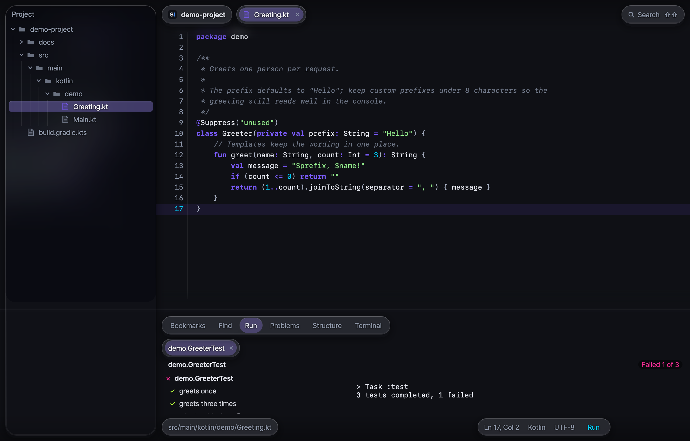</td>
<td valign="top">

- **테스트 실행** `src/test` 아래 `.kt` 파일의 클래스 줄과 `@Test` 함수마다 거터에 `▶` 가 붙습니다. 눌러서 그 테스트를 실행합니다. `⌃⇧R` 은 커서 위치의 테스트를, 없으면 파일의 main 이나 스크립트를 실행합니다. 트리에서 테스트 파일이나 테스트 디렉터리를 고르고 `⌃⇧R`(또는 우클릭 메뉴의 `Run '…'`)을 누르면 그 안의 테스트를 실행하며, 디렉터리는 그 아래 파일의 `package` 줄로 테스트 클래스를 모으고 모듈 디렉터리·`src`·`src/test` 는 그 모듈의 `test` 작업 전체를 실행합니다
- **main 실행** Kotlin·Java 의 `main` 함수 줄에도 거터 `▶` 가 붙습니다. `⌃R` 은 마지막 실행이 있으면 다시 실행하고, 없으면 `⌃⇧R` 과 같은 대상을 실행합니다. `.py`·`.sh`·`.js`·`.rb`·`.kts` 스크립트와 Gradle 밖 단일 Java 파일은 직접 실행하고, Gradle 소스셋의 Kotlin·Java 는 `strideRunMain` 작업으로 실행합니다
- **인텐션·퀵픽스와 실행 구성** `⌥↩` 는 커서 위치의 퀵픽스, 인텐션, 실행 항목을 묶음별로 나눈 팝업을 엽니다. Kotlin 에서는 프로젝트 선언 인덱스로 찾은 미해결 심볼을 import 하고, import 블록에서 안 쓰는 import 를 지우고, `val`·`var` 를 바꿉니다. 실행 묶음에는 커서 위치에서 실행할 main·테스트와 다시 실행·중지가 그대로 남습니다. 첫 항목이 기본 선택이므로 퀵픽스나 인텐션이 있으면 `Enter` 가 실행 대신 그 항목을 적용하고, 적용한 편집은 `⌘Z` 한 번으로 되돌립니다. `⌃⌥R` 은 현재 파일의 실행 항목과 최근 실행 10개를 보여 주고 `Enter` 로 실행합니다. `⌘F9` 는 `classes`·`testClasses` 를 빌드합니다
- **Run 창** 실행 세션이 둘 이상이거나 끝난 세션이 있으면 창 위에 탭이 생기고 `×` 로 닫습니다. 테스트 실행은 트리와 콘솔로 나눠 통과·실패·건너뜀 수를 세고, 메서드를 고르면 메시지와 스택, 그 테스트의 출력을 보여 줍니다. 애플리케이션 실행은 콘솔만 보여 주며 콘솔 아래 입력 줄로 표준 입력을 보냅니다. `⌘F2` 로 중지하고 `⌘R` 로 다시 실행하며 `⌘4` 로 창을 엽니다. 테스트 트리 행을 우클릭하면 그 클래스나 메서드만 실행하는 `Run '…'` 와 Rerun·Stop 이, 콘솔을 우클릭하면 Rerun·Stop 이 나옵니다
- **항상 실행** Gradle init script 가 `Test` 작업의 최신 검사와 빌드 캐시를 끕니다. 같은 테스트를 다시 돌려도 건너뛰지 않고 이벤트를 보고합니다

</td>
</tr>
</table>

### 터미널

<table width="100%">
<tr>
<td width="44%" valign="top">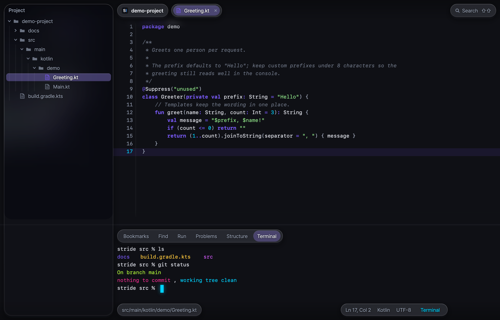</td>
<td valign="top">

- **내장 터미널** `⌥F12` 로 Terminal 창을 엽니다. 프로젝트 디렉터리에서 로그인 셸을 실제 PTY(pty4j)로 띄우고 jediterm 이 화면을 그립니다
- **네온 ANSI 팔레트** 16색 ANSI 팔레트가 나머지 화면과 같은 네온 계열입니다. 커서는 `accent2` 색입니다
- **숨기기** `⇧Esc` 로 창을 숨기고 포커스를 원래 자리로 돌려줍니다
- **우클릭 메뉴** 터미널을 우클릭하면 Copy·Paste 가 뜹니다. 선택이 없으면 Copy 가 흐리게 보이고, 우클릭은 선택을 지우지 않습니다

</td>
</tr>
</table>

### Git

<table width="100%">
<tr>
<td width="44%" valign="top">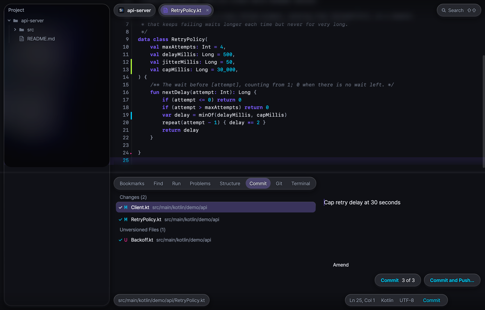<br><br>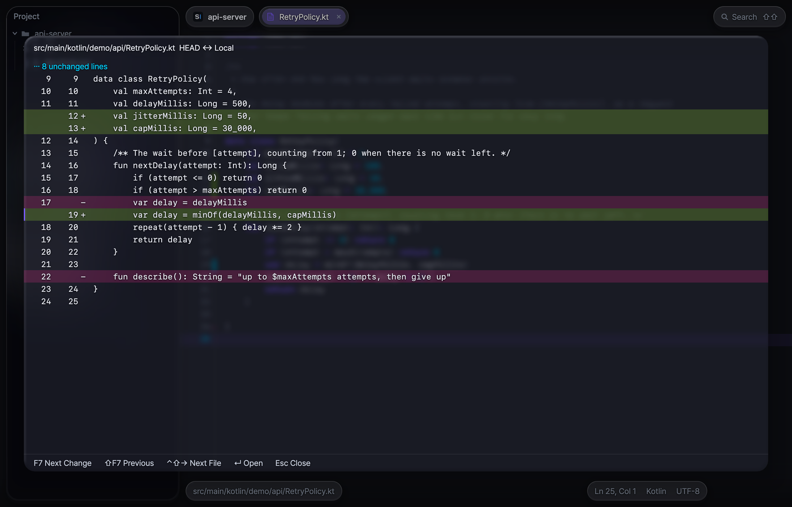<br><br>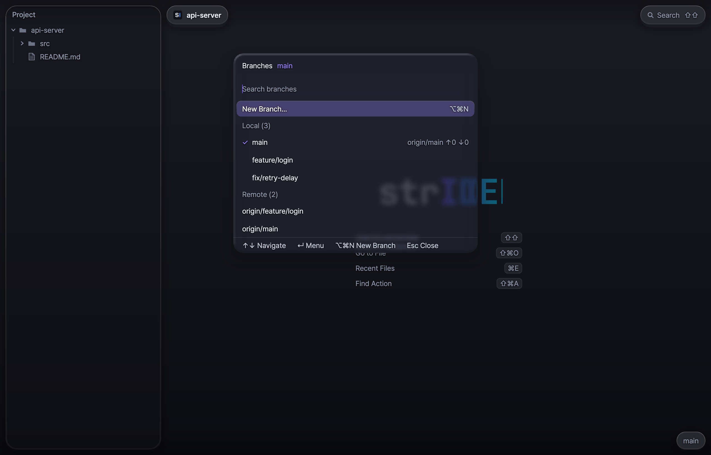</td>
<td valign="top">

- **변경 표시** 프로젝트가 Git 저장소 안에 있으면 거터 오른쪽 끝에 HEAD 와 다른 줄이 표시됩니다. 추가한 줄과 바꾼 줄은 색 막대로, 지운 자리는 작은 삼각형으로 나타나고, 입력이 멈추고 100 ms 뒤에 다시 비교하므로 저장하지 않은 편집도 바로 반영됩니다. 표시를 누르면 HEAD 의 원래 줄과 `Rollback ⌥⌘Z`·`Show Diff` 버튼이 있는 팝업이 뜹니다
- **줄 되돌리기와 변경 이동** `⌥⌘Z` 는 캐럿이나 선택에 걸친 변경을 HEAD 의 줄로 되돌리고 `⌘Z` 한 번으로 취소됩니다. 파일은 저장하지 않습니다. `⌃⌥⇧↓` / `⌃⌥⇧↑` 는 다음 / 이전 변경으로 이동합니다
- **커밋** `⌘K` 는 Commit 창을 열고 메시지 칸에 포커스를 둡니다. 변경 파일과 버전 관리되지 않은 파일이 체크박스와 함께 나오고 `⌘↩` 로 체크한 파일만 커밋합니다. 체크한 파일의 저장하지 않은 에디터는 커밋 전에 저장하고, 스테이징 영역은 따로 다루지 않습니다. 창에서 `⌘D` 는 고른 파일의 diff 를 엽니다. 파일 행을 우클릭하면 그 행을 고르고(체크는 그대로) Rollback…·Show Diff·Jump to Source 와 Git 하위 메뉴가 뜹니다
- **푸시** `⇧⌘K` 는 현재 브랜치와 보낼 커밋을 보여 주는 확인 팝업을 띄우고 `↩` 로 푸시합니다. 강제 푸시와 태그 푸시는 하지 않습니다. 인증이 필요한 원격은 프롬프트 없이 실패하고 상태 표시줄에 터미널에서 다시 시도하라고 알립니다
- **커밋하고 푸시** Commit 창에서 `⌥⌘K` 나 `Commit and Push…` 버튼을 누르면 체크한 파일을 커밋한 뒤 같은 푸시 확인 팝업을 띄웁니다. Commit 창 밖에서 누르면 `⌘K` 처럼 Commit 창을 엽니다
- **파일 되돌리기** Commit 창에서 `⌥⌘Z` 를 누르면 고른 파일 하나만 체크된 Rollback 팝업이 뜹니다. `Space` 로 다른 변경을 더 체크하고 `↩` 를 누르면 체크한 파일이 HEAD 의 내용으로 돌아가며, 저장하지 않은 편집도 함께 버려집니다. 열린 에디터에서는 `⌘Z` 로 버린 내용을 되살릴 수 있지만 열려 있지 않은 파일은 되살릴 수 없습니다. 한 번도 커밋하지 않은 새 파일은 지우지 않고 버전 관리되지 않은 파일로 남깁니다. 에디터에서는 VCS 팝업의 `9 Rollback…` 이 그 파일을 체크한 같은 팝업을 엽니다
- **amend** Commit 창의 `Amend` 체크박스나 `⌃⌥M` 으로 Amend 를 켜면 메시지 칸에 마지막 커밋의 메시지가 채워지고, `Amend Commit` 이 체크한 파일과 그 메시지로 마지막 커밋을 고칩니다. 파일을 하나도 체크하지 않으면 메시지만 고칩니다. 끄면 켜기 전에 쓰던 메시지로 돌아갑니다. 원격 추적 브랜치에 이미 들어간 커밋은 강제 푸시가 필요하므로 amend 하지 않습니다
- **프로젝트 업데이트** `⌘T` 는 현재 브랜치의 업스트림 원격을 fetch 한 뒤 들어올 커밋을 보여 주는 확인 팝업을 띄우고, `↩` 로 브랜치를 갱신합니다. 뒤처지기만 한 브랜치는 fast-forward 하고, 갈라진 브랜치는 `Tab` 으로 Merge 와 Rebase 중에서 고릅니다. 기본값은 git 의 `branch.<이름>.rebase`·`pull.rebase` 설정을 따릅니다. 갱신으로 바뀐 파일의 탭은 새 내용을 다시 읽습니다. stash 는 만들지 않습니다. fast-forward 는 저장하지 않은 에디터를 먼저 저장하고, 로컬 변경을 덮어쓰게 되면 git 이 멈춥니다. merge·rebase 는 커밋하지 않은 변경과 저장하지 않은 에디터가 없을 때만 실행합니다. 충돌이 나면 갱신 전 상태로 되돌리고 터미널에서 다시 하라고 알립니다
- **브랜치** VCS 팝업의 `0 Branches…`, 상태 표시줄의 브랜치 이름, Find Action 의 `Branches…`·`New Branch…` 로 브랜치 팝업을 엽니다(전역 단축키는 없습니다). 검색 칸에 입력하면 이름으로 거르고, `New Branch…` 아래에 현재 브랜치를 맨 위에 둔 로컬 브랜치(업스트림과 `↑`/`↓` 커밋 수)와 원격 브랜치가 나오며, 행에서 `↩` 나 `→` 로 메뉴를 열어 Checkout·새 브랜치·이름 바꾸기·삭제를 고릅니다. 체크아웃은 저장하지 않은 에디터를 먼저 저장하고 로컬 변경을 덮어쓰게 되면 git 이 멈추며 stash 는 만들지 않고, 바뀐 파일의 탭은 새 내용을 다시 읽습니다. 원격 브랜치는 그것을 추적하는 같은 이름의 로컬 브랜치를 만들어 체크아웃하고, 어느 브랜치에도 없는 커밋이 있는 detached HEAD 에서는 먼저 브랜치를 만들라고 알린 뒤 체크아웃하지 않습니다. 팝업 안의 `⌥⌘N` 은 `Checkout branch` 체크박스(기본 켬, `Tab` 으로 바꿈)가 있는 새 브랜치 이름 화면을 열고, 잘못된 이름과 이미 있는 이름은 입력하는 동안 알립니다. 원격 브랜치에서 만든 새 브랜치는 그 원격 브랜치를 추적하지 않으므로, 첫 푸시가 같은 이름의 원격 브랜치를 만듭니다. 이름 바꾸기는 업스트림을 그대로 두고 어디로 푸시되는지 알리며, 삭제는 병합된 브랜치면 바로 지우고 아니면 잃게 될 커밋을 보여 주고 한 번 더 확인하며 원격 브랜치는 지우지 않습니다
- **fetch** VCS 팝업의 `8 Fetch` 는 모든 원격을 가져오기만 하고 브랜치와 파일은 바꾸지 않습니다. git 이 실행되는 동안 상태 표시줄에 `Fetching…`·`Updating…`·`Pushing…` 같은 진행 문구가 보입니다
- **diff 와 Git 창** diff 는 HEAD 와 현재 내용을 한 열로 보여 주고 `F7` / `⇧F7` 로 변경 사이를 이동합니다. `⌘9` Git 창의 Log 탭은 최근 커밋을 보여 주고 `↩` 나 행 우클릭 메뉴의 Show Diff 로 그 커밋의 diff 를 열며, Console 탭은 stride 가 실행한 git 명령과 출력을 보여 줍니다. `⌃V` 는 이 명령들을 번호로 모은 VCS 팝업입니다
- **우클릭 메뉴** 에디터·프로젝트 트리·Commit 창의 우클릭 메뉴에 있는 Git 하위 메뉴의 Commit…·Rollback…·Show Diff·Push…·Update Project…·Fetch·Branches…·New Branch… 는 VCS 팝업의 같은 행과 같은 일을 하고, 트리에서 연 Show Diff 는 고른 파일의 diff 를 엽니다

</td>
</tr>
</table>

### 메뉴 막대

- **화면 메뉴 막대** macOS 화면 위 메뉴 막대에 File, Edit, View, Navigate, Code, Refactor, Build, Run, Git, Window, Help 열한 메뉴가 IntelliJ 와 같은 순서와 하위 메뉴로 뜹니다. stride 에 있는 액션만 행으로 나오고, 창 안에는 메뉴 줄이 생기지 않습니다
- **자리 기준 판정** 메뉴를 열 때마다 키보드가 있는 곳(에디터, 프로젝트 트리, 터미널, 도구 창)을 기준으로 행을 다시 판정합니다. 그 자리에서 실행할 수 없는 행은 흐리게 보이고, 팝업이 키보드를 가진 동안에는 모든 행이 흐립니다. 행은 그 자리에서 단축키를 누른 것과 같은 일을 하고, 고를 때 한 번 더 판정해 그사이 상태가 바뀌어 실행할 수 없게 된 행은 아무것도 하지 않습니다
- **행 뒤 단축키** 행 글자 뒤에 그 자리에서 실행되는 단축키를 적어 보여 줍니다. 같은 키라도 에디터와 트리에서 하는 일이 다르면 그 자리의 행에만 붙습니다. 메뉴는 단축키를 등록하지 않으므로 키 입력은 메뉴를 거치지 않고 예전과 똑같이 처리되고, 한 번 누른 키가 메뉴 때문에 두 번 실행되거나 사라지지 않습니다
- **Cut·Copy·Paste·Delete** Edit 의 Cut·Copy·Paste·Delete 는 키보드가 있는 곳의 `⌘X`·`⌘C`·`⌘V`·`⌫` 와 같은 일을 합니다. 에디터에서는 선택이나 줄, 트리에서는 파일, 터미널에서는 Copy·Paste 입니다
- **Recent Projects** File › Recent Projects 는 전에 연 폴더를 최근 것부터 20개까지 보여 주고, 고르면 그 폴더를 엽니다. 지금 연 폴더는 빠지고, 이름이 같은 폴더는 상위 경로를 붙여 구별합니다. 사라진 폴더를 고르면 목록에서 지우고 상태 줄에 `Folder not found: <경로>` 를 띄웁니다. 목록은 `java.util.prefs` 의 `stride` 노드 `recentProjects` 키(UI 글꼴 설정과 같은 노드)에 남습니다

### 리퀴드 글래스 UI

<table width="100%">
<tr>
<td width="44%" valign="top"></td>
<td valign="top">

- **시스템 유리** macOS 26 이상에서는 창 콘텐츠 뒤에 시스템의 유리 뷰를 깔아, 사이드바·캡슐·찾기 바·팝업으로 데스크톱과 다른 창이 비칩니다. 에디터는 거터까지, 툴 창은 콘솔·터미널 본문까지 유리라 화면 어디에서나 데스크톱이 비칩니다
- **읽히는 코드** 네이티브 경로에서 코드·거터·콘솔·터미널 색은 밝은 데스크톱과 어두운 데스크톱 위에서 모두 4.5:1 을 지킵니다. 선택과 찾기 일치가 겹쳐 가장 어두워지거나 가장 밝아진 판에서도 같습니다
- **제목 줄** 제목 줄을 숨기고 신호등을 상단 캡슐 줄에 맞춥니다. 그 줄의 빈 곳을 끌면 창이 움직이고, 두 번 누르면 시스템의 제목 줄 두 번 클릭 설정을 따릅니다
- **라이트·다크** 시스템 외관을 실행 중에 따라갑니다. 팔레트와 문법 색, 터미널 색에 라이트·다크 두 벌이 있어 앱을 다시 시작하지 않아도 바뀝니다. 네이티브 경로에서는 창 외관을 팔레트에 맞춰 두므로 시스템 유리의 재질과 글자색이 늘 같은 외관을 따릅니다
- **이전 macOS** macOS 26 미만이거나 네이티브 라이브러리가 없으면 이전의 창 안 유리와 표준 제목 줄을 씁니다
- **배경** 네이티브 유리가 꺼진 경로에서는 중립 그라파이트 바탕에 위에서 아래로 은은히 어두워지는 휘도 폴오프를 깔아 창 뒤에 둡니다. 색은 강조 요소에만 씁니다
- **대체 경로의 유리 범위** 대체 경로에서는 유리를 사이드바·상하단 캡슐·찾기 바·팝업·도구 창 전환기처럼 조작에 쓰는 층에만 쓰고, 에디터와 콘솔은 그 위에 뜬 불투명한 둥근 판입니다. 네이티브 경로에서는 에디터와 툴 창 본문도 유리입니다. 어느 경로든 바나 판이 창을 가로지르지 않습니다
- **떠 있는 유리 사이드바** 위·왼·아래 10 dp 띄운 둥근 유리 판입니다. 대체 경로에서는 바로 옆의 실제 코드를 뒤집어 흐린 색장을 판 아래에 깔아 사이드바가 옆 코드의 색조를 머금고, 판 바깥은 에디터 필드와 같은 픽셀로 남습니다. 네이티브 경로에서는 판 자체가 데스크톱을 비춥니다
- **바 대신 캡슐** 상단은 프로젝트 이름 캡슐·탭 캡슐 그룹·Search 캡슐로, 하단은 파일 경로 캡슐과 상태 캡슐 그룹으로 나뉩니다. 선택한 탭은 그룹 안의 유리 알약이 미끄러지듯 옮겨 가고, 그 알약 하나가 선택을 즉시 알립니다. 상태 캡슐 그룹은 `Ln`·`Col`, 파일 종류, `UTF-8`, 읽기 전용 표시를 담습니다. 캡슐은 뒤를 흐려 라벨을 읽히게 하고, 캡슐 사이의 빈 곳은 그 아래(대체 경로에서는 코드)가 그대로 보이고 클릭됩니다
- **스크롤 엣지 효과** 스크롤한 코드는 상단·하단 캡슐 줄 아래에서 서서히 흐려지며 창 가장자리로 사라집니다. 바가 덮어 자르는 대신 흐림이 점진적으로 풀립니다
- **얇은 팝업** 대체 경로에서는 Search Everywhere·최근 파일·컨텍스트 액션 팝업이 코드 위에 얇은 유리로 뜨고, 뒤의 코드를 비추며 가장자리에서 휘게 합니다. 굵은 텍스트 그림자가 라벨을 읽히게 하고, 셰이더를 쓸 수 없으면 블러와 헤어라인으로 대체합니다. 네이티브 경로에서는 팝업마다 자기 시스템 유리 조각이 덮는 표면 위에 뜨고, 라벨 아래에 팔레트 바탕을 깔아 밝은 데스크톱과 어두운 데스크톱 위에서 모두 글자 대비 4.5:1 이상을 지킵니다
- **팝업 그림자** 네이티브 경로의 팝업은 시스템이 그리는 부드러운 그림자로 유리 판이 데스크톱 위에 떠 보이고, 모달일 때 창을 덮는 어둡기는 훨씬 옅습니다
- **웰컴 화면** 프로젝트가 없으면 워드마크가 화면의 콘텐츠가 되고, 그 아래 `Open Folder…` 유리 캡슐과 키캡 힌트가 놓입니다
- **선택 신호** 선택한 트리 행은 작은 렌즈가 든 캡슐로 떠오르고, 그 안의 알약 하나와 흰 텍스트로 표시합니다. 포커스를 받은 트리 패널은 테두리에 얇은 선을 그립니다
- **큰 파일** 1,000줄 이상 문서는 상수 비용 스크롤 레이어로 그려 프레임 비용을 묶고, 그때 캡슐은 캐시한 프로스트 채움을 씁니다. 800줄 아래로 줄어야 레이어를 풉니다
- **모션과 비용** 선택한 탭의 필은 200 ms 동안 미끄러지고 상시 애니메이션은 없습니다. 캡슐 프로스트와 팝업 렌즈는 저해상도 사본에서 계산하고, 배경 확장과 스크롤 엣지 흐림은 결과를 캐시해 정지 프레임에서 다시 계산하지 않습니다
- **UI 글꼴** 번들된 UI 글꼴을 쓰고, Actions 탭의 `Switch UI Font` 로 시스템 글꼴과 전환합니다. 선택은 저장되어 다음 실행에도 유지됩니다

</td>
</tr>
</table>

<p align="center">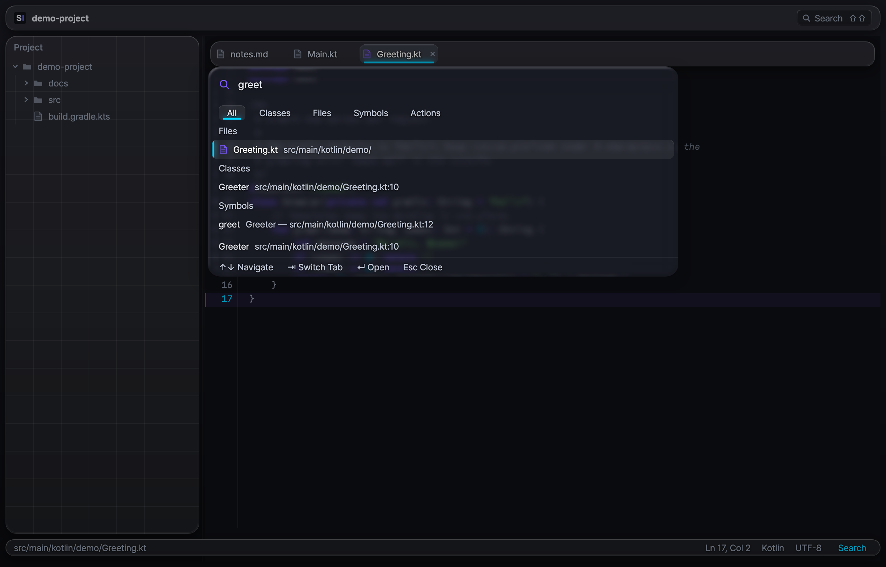</p>

<p align="center">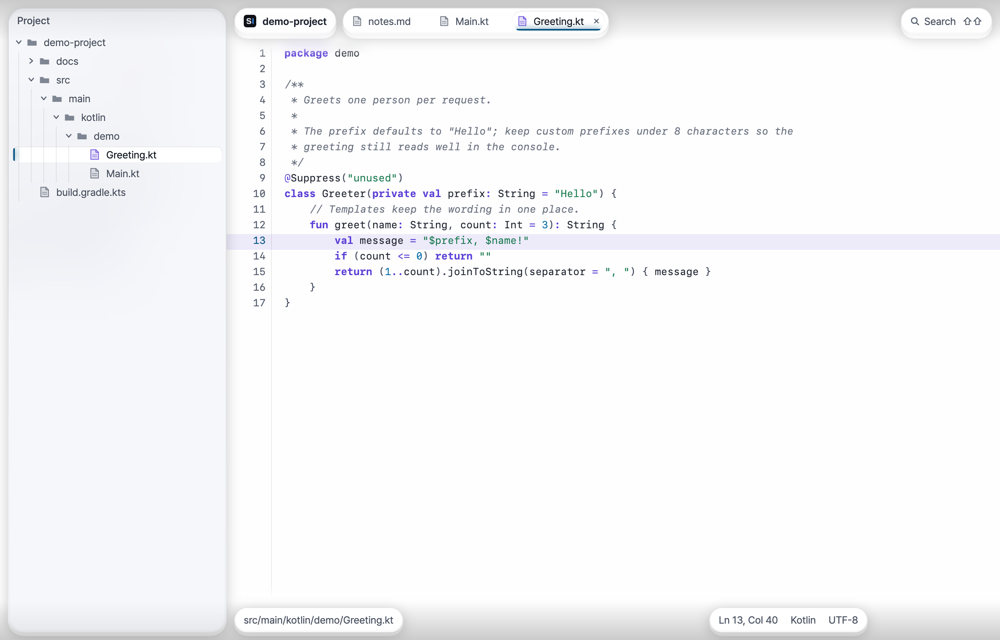</p>

<br>

## 사용법

### 키보드

아래는 기본 키입니다. 단축키는 IntelliJ IDEA 의 macOS 기본 키맵과 호환됩니다. macOS 가 아닌 플랫폼에서는 Command 와 Control 이 서로 바뀌어(`⌘S` 는 `Ctrl+S`, `⌃R` 은 `Meta+R`) `Ctrl`·`Alt`·`Shift`·`Meta` 라벨로 표시됩니다. 전체 목록과 문맥별 우선순위의 정본은 `app/src/main/kotlin/stride/app/keys/Keymap.kt` 의 `bind(` 호출입니다. 메뉴 막대 행 뒤에 적힌 단축키도 이 표의 키이고, 메뉴는 키를 따로 받지 않습니다.

| 키 | 동작 |
|---|---|
| **파일과 탭** | |
| `⌘S` | 열린 에디터 모두 저장 |
| `⌘W` | 탭 닫기 |
| `⌘⇧]` `⌃→` / `⌘⇧[` `⌃←` | 다음 탭 / 이전 탭 |
| `⌘1` / `⌘⇧F12` | 프로젝트 트리에 키보드 주기·닫기 / 모든 도구 창 숨기기·복원 |
| Actions 탭 · 탭 우클릭 메뉴 | Reopen Closed Tab · Close Other Tabs · Close All Tabs · Close Tabs to the Left · Close Tabs to the Right |
| **프로젝트 트리** | |
| `↑` `↓` / `→` `←` / `↵` `F4` / `Esc` | 행 고르기 / 폴더 펼치기·접기 / 파일 열기 / 에디터로 돌아가기 |
| `⌘N` `⌃↩` | 새 Kotlin 클래스·파일·디렉터리 |
| `⇧F6` / `F6` / `F5` | 이름 바꾸기 / 이동 / 복사 |
| `⌫` `⌦` `⌘⌫` | 휴지통으로 옮기기 |
| `⌘X` / `⌘C` / `⌘V` | 파일 잘라 내기 / 복사 / 붙여넣기 |
| `⌃⇧R` | 고른 테스트 파일·디렉터리 실행 |
| Actions 탭 · 우클릭 메뉴 `Open In` | Reveal in Finder · Open in Terminal |
| **검색과 이동** | |
| `⇧⇧` | Search Everywhere (All 탭) |
| `⌘O` | 클래스로 이동. 프로젝트가 없으면 폴더 열기 |
| `⌘⇧O` / `⌘⌥O` | 파일 / 심볼로 이동 |
| `⌘⇧A` | 액션으로 이동 |
| `⌘⇧F` | 프로젝트 텍스트 검색 (팝업의 `⌘↵` 는 Find 창에서 열기) |
| `⌘E` / `⌃Tab` `⌃⇧Tab` | 최근 파일 / 최근 파일 전환기 |
| `⌥F1` / `⌘⇧C` / `⌘⌥⇧C` | 트리에서 현재 파일 드러내기 / 경로 복사 / 참조 복사 |
| **에디터 편집** | |
| `⌘D` | 줄 또는 선택 복제 |
| `⌘⌫` | 줄 삭제 |
| `⌥⇧↑` / `⌥⇧↓` | 줄 위로 이동 / 아래로 이동 |
| `⌘/` · `⌘⌥/` | 줄 주석 토글 · 블록 주석 토글 |
| `Tab` / `⇧Tab` | 들여쓰기 / 내어쓰기 |
| `⌘L` | 줄로 이동 |
| `Esc` | 줄로 이동 닫기, 보조 캐럿 지우기, 사용처 강조 지우기, 선택을 커서로 접기 |
| `⌘Z` / `⌘⇧Z` | 실행 취소 / 다시 실행 |
| `⌥↑` / `⌥↓` | 선택 넓히기 / 좁히기 |
| `⌘⇧U` | 대소문자 바꾸기 |
| `⌃⇧J` | 줄 합치기 |
| `⇧↩` / `⌘⌥↩` | 아래 / 위에 새 줄 |
| `⌃M` | 짝 괄호로 이동 |
| `⌘⌥[` / `⌘⌥]` | 코드 블록 시작 / 끝으로 이동 |
| `⌃⇧↑` / `⌃⇧↓` | 위 / 아래 메서드로 이동 |
| `⌥/` | 단어 자동 완성 |
| `⌃Space` · `⌃⌥Space` | 자동 완성 팝업 |
| `⌃⇧Space` | 타입·식 자리로 거른 자동 완성 |
| `⇧F6` | 파일 안에서 이름 바꾸기 |
| `⌘C` / `⌘X` | 선택 없이 줄 복사 / 잘라내기 |
| `⌘⇧V` | 복사 기록에서 붙여넣기 |
| `⌘⇧↑` / `⌘⇧↓` | 문장 위로 이동 / 아래로 이동 |
| `⌘⇧↩` | 문장 마무리 |
| `⌘⇧⌦` | 감싼 블록 풀기 |
| `⌘⌥T` | 템플릿으로 감싸기 |
| `⌘⌥L` | 코드 정리 |
| `⌃⌥O` | import 정리 |
| `⌃L` | 커서 줄을 가운데로 스크롤 |
| `⌘P` | 파라미터 정보 |
| `F1` · `⌃J` / `⌥Space` | 선언 문서 / 선언 원문 보기 |
| **리팩터링** | |
| `⌃T` | Refactor This (커서 위치에서 가능한 것만) |
| `⌥⌘V` | 변수 도입 |
| `⌥⌘M` | 메서드 추출 |
| `⌥⌘N` | 인라인 (에디터) |
| **생성** | |
| `⌘N` / `⌃↩` | Generate (커서의 클래스에 만들 수 있는 것만) |
| `⌃O` | 멤버 덮어쓰기 |
| `⌃I` | 멤버 구현 |
| **멀티 캐럿** | |
| `⌃G` / `⌃⇧G` | 다음 일치 선택에 더하기 / 마지막에 더한 선택 빼기 |
| `⌃⌘G` | 모든 일치 선택 |
| `⌥⇧`-클릭 | 캐럿 추가·제거 |
| `⌥⌥↑` / `⌥⌥↓` | 캐럿 위로 / 아래로 복제 (두 번째 `⌥` 를 누른 채) |
| `⌥`-드래그 | 사각 선택 |
| `⌘⇧8` | 열 선택 모드 토글 |
| **코드 접기** | |
| `⌘=` / `⌘-` | 펼치기 / 접기 (숫자패드 `⌘+` / `⌘-` 도 같음) |
| `⌘⇧=` / `⌘⇧-` | 모두 펼치기 / 모두 접기 |
| **찾기** | |
| `⌘F` | 찾기 바 열기 |
| `⌘R` | 바꾸기 줄 펼치기 |
| `⌘G` / `⌘⇧G` | 다음 일치 / 이전 일치 |
| `⌘⇧R` | Replace in Path (`⌥⌘↵` 전체 바꾸기, `⌘↵` Find 창에서 미리보기) |
| **탐색** | |
| `⌘B` · `⌘`-클릭 | 선언으로 이동 |
| `⌘[` `⌘⌥←` / `⌘]` `⌘⌥→` | 뒤로 / 앞으로 |
| `⌘F12` | 파일 구조 |
| `⌘⇧T` | 테스트로 이동 |
| `⌥F7` | 사용처 찾기 (Find 창에 탭 추가) |
| `⌘⌥F7` | 사용처 팝업 (`⌘↵` 는 Find 창에서 열기) |
| `⌘⇧F7` | 파일 안 사용처 강조 (`⌘G` / `⌘⇧G` 로 이동) |
| `⌘⇧E` | 최근 위치 |
| `⌘⇧⌫` | 마지막 편집 위치 |
| `⌥Home` · `⌘↑` (목록 창) | 탐색 막대 |
| `F4` · `⌘↓` (목록 창) | 소스 열기 (에디터는 선언으로, 목록 창은 고른 항목 열기) |
| `⌘2` / `⌘3` / `⌘6` / `⌘7` | Bookmarks / Find / Problems / Structure 창 |
| `F3` / `⌘F3` | 북마크 토글 / 북마크 목록 |
| `F2` / `⇧F2` | 다음 문제 / 이전 문제 |
| `⌘F1` | 커서 위치 문제 설명 |
| `⌘⌥B` / `⌘U` | 구현으로 이동 / 상위 메서드로 이동 |
| `⌘⇧B` `⌃⇧B` | 타입 선언으로 이동 |
| `⌃H` / `⌃⌥H` | 타입 계층 / 호출 계층 창 |
| **Run** | |
| `⌥↩` | 컨텍스트 액션 |
| `⌃⇧R` | 커서 위치의 테스트, 없으면 파일의 main 실행 (트리에서는 고른 테스트 파일·디렉터리 실행) |
| `⌃R` | 마지막 실행 다시 실행, 없으면 커서 위치의 테스트나 파일의 main 실행 |
| `⌃⌥R` | 실행 구성 선택 |
| `⌘F9` | 빌드 |
| `⌘F2` | 실행 중지 |
| `⌘4` · `⌘R` (Run 창) | Run 창 열기 · Run 창에서 다시 실행 |
| **터미널** | |
| `⌥F12` | Terminal 창 열기 |
| `⇧Esc` | 도구 창 숨기기 (Bookmarks·Find·Run·Problems·Structure·Terminal·Commit·Git 창) |
| **Git** | |
| `⌘K` | Commit 창 열기 (`⌘↩` 커밋, `Space` 파일 체크, `⌘D` diff, `Tab` 목록과 메시지 사이 이동) |
| `⇧⌘K` | 푸시 확인 팝업 |
| `⌥⌘K` | 커밋하고 푸시 (Commit 창 밖에서는 Commit 창 열기) |
| `⌘T` | 프로젝트 업데이트 (`Tab` Merge/Rebase, `↩` 실행) |
| `⌃V` | VCS 팝업 (터미널에서는 셸로 전달) |
| `⌥⌘Z` | 줄 되돌리기 (에디터) · 파일 되돌리기 팝업 (Commit 창, `Space` 체크, `↩` 실행) |
| `⌃⌥M` | Amend 켜기·끄기 (Commit 창) |
| `⌃V` `0` | 브랜치 팝업 |
| `⌥⌘N` (브랜치 팝업) | 새 브랜치 (`Tab` 체크아웃 켜기·끄기, `↩` 실행) |
| `⌃⌥⇧↓` / `⌃⌥⇧↑` | 다음 변경 / 이전 변경 |
| `⌘0` / `⌘9` | Commit / Git 창 |
| `F7` / `⇧F7` · `⌃⇧→` / `⌃⇧←` (diff) | 다음 / 이전 변경 · 다음 / 이전 파일 |
| **우클릭 메뉴** | |
| 우클릭 · `⌃`-클릭 | 메뉴 열기 |
| `↑` `↓` · `→` `←` · `↵` · `Esc` | 행 고르기 · 하위 메뉴 열기·닫기 · 실행 · 닫기 |
| **기타** | |
| Actions 탭 | Switch UI Font |

<br>

## 설치

### Homebrew

```sh
brew tap lcalmsky/stride https://github.com/lcalmsky/stride
brew trust lcalmsky/stride
brew install --cask lcalmsky/stride/stride
```

같은 저장소를 tap 으로 쓰고 Cask 는 `Casks/stride.rb` 에 있습니다. 짧은 이름 `stride` 는 다른 tap 과 겹칠 수 있어 `lcalmsky/stride/stride` 전체 이름으로 설치합니다. `brew trust` 는 공식 tap 이 아닌 tap 의 Cask 를 Homebrew 가 불러올 수 있게 신뢰 처리합니다.

### 소스에서 빌드

```sh
git clone https://github.com/lcalmsky/stride.git
cd stride
./gradlew :app:run                       # 개발 실행
./gradlew :app:createDistributable       # app/build/compose/binaries/main/app/strIDE.app
```

JDK 21 이 필요합니다. Gradle toolchain 이 21 을 요구합니다.

### 필요 조건

| 조건 | 비고 |
|---|---|
| macOS Apple Silicon (arm64) | 릴리즈 앱은 arm64 전용입니다. 번들 런타임이 들어 있어 JDK 설치가 필요 없습니다 |
| macOS 26 이상 (선택) | 시스템 유리를 쓰는 조건입니다. 그보다 낮으면 앱 안에서 그리는 유리로 동작합니다 |
| Git (선택) | Git 기능은 설치된 `git` 명령을 씁니다. 없으면 Git 동작이 `Git is not installed` 를 알립니다 |
| JDK 21 | 소스에서 빌드할 때만 필요합니다 |
| Gatekeeper | zip 을 직접 받아 풀면 첫 실행에서 경고가 뜰 수 있습니다. Finder 에서 앱을 우클릭하고 `열기` 를 고릅니다 |

<br>

## 동작 방식

앱은 여섯 모듈로 나뉩니다. `core` 는 서비스·확장점·`Disposer` 를 제공하고, `lang` 은 언어와 파일 종류·하이라이터·주석 처리·인텐션·import 정리·문제 제공자 API 를 정의합니다. `search` 는 파일 이름 인덱스, Kotlin·Java 선언 인덱스, Search Everywhere 의 모델을, `app` 은 Compose Desktop UI 와 에디터·탐색·북마크·Run·터미널을 담습니다. `plugins/lang-kotlin` 과 `plugins/lang-json` 이 각각 Kotlin 과 JSON 의 렉서·하이라이터·파일 종류와 괄호 짝을 판정하는 문제 제공자를 등록하고, Kotlin 플러그인은 import 퀵픽스와 `val`·`var` 인텐션, import 정리기, 안 쓰는 import 경고도 등록합니다.

모든 모듈은 `META-INF/stride-plugin.xml` 디스크립터로 확장점을 선언하고 확장을 등록합니다. 앱 디스크립터가 파일 종류, 문법 하이라이터, 주석 처리, 인텐션, import 정리, 문제 제공자, 리팩터링 제공자, 생성 제공자, 에디터, 트리 구조, Search Everywhere 기여자 확장점을 열고, 언어 플러그인과 앱 자신이 그 확장점에 등록합니다. 클래스·심볼 검색은 선언 인덱스를 읽는 기여자로 등록되고, 액션 검색은 앱이 직접 구성합니다. 선언 인덱스는 상위 타입과 import, 멤버 범위도 읽고, 계층 탐색 액션은 이 정보로 타입 그래프를 만듭니다. Git 기능은 `git` 명령을 자식 프로세스로 실행하는 프로젝트 서비스 `GitService` 가 맡습니다. 상태는 `git status --porcelain=v2` 로 읽고, 거터 표시는 HEAD 의 파일 내용과 에디터 텍스트를 프로세스 안에서 줄 단위로 비교해 만듭니다. 자세한 계약은 [core](docs/api-core.md) · [lang](docs/api-lang.md) · [search](docs/api-search.md) · [app](docs/api-app.md) 에 있습니다. 우클릭 메뉴는 `stride.app.actions.ActionGroups` 의 액션 그룹(IntelliJ 그룹 id 를 쓰는 코드 정의)을 읽어 그리고, 행의 활성 여부는 그 액션이 쓰는 판정 함수를 그대로 불러 정합니다.

메뉴 막대도 같은 액션 그룹 정의(`app/src/main/kotlin/stride/app/actions/ActionGroups.kt`)에서 Swing 메뉴를 만들어(`actions/MainMenuBar.kt`) macOS 화면 메뉴 막대일 때만 창에 답니다. 항목에 가속기를 등록하지 않아 키는 `KeyRouter` 만 처리하고, 행의 활성 여부는 디스패처가 액션을 실행하지 않고 같은 결과를 판정하는 `canDispatch` 로 정합니다.

에디터는 스크롤 뷰포트와 크롬 인셋을 따로 둡니다. 내용은 창 가장자리까지 이어지고 유리 캡슐과 사이드바가 그 위에 떠 있으며, 인셋은 캐럿 스크롤·거터·스크롤바 여백에 반영됩니다. 1,000줄 이상 문서는 내용을 별도 스크롤 레이어에 배치하고 800줄 아래로 내려가면 레이어를 풉니다.

네이티브 경로에서는 JNI 라이브러리가 창 콘텐츠 아래에 시스템 유리 뷰를 배치하고 Compose 는 그 위의 조각들만 보고합니다. 라이브러리가 없거나 macOS 26 미만이면 같은 조각 정보를 Skia 재질로 그리는 경로로 대체합니다.

<br>

## 개발

```sh
./gradlew test                    # 테스트. 실패 0 이어야 합니다
./gradlew :app:createDistributable
./gradlew :app:run                # 창을 띄우므로 직접 실행합니다
```

- 테스트는 580여 건이고 약 2분 걸립니다. `UiSnapshotTest` 가 `app/build/ui-snapshots/` 에 화면 PNG 를 씁니다
- `:app:buildNativeGlass` 는 `clang++`(Xcode Command Line Tools)가 있을 때만 실행됩니다. 없으면 한 줄 로그를 남기고 앱은 Skia 유리 경로로 동작합니다. `-Pstride.nativeGlass=false` 로 네이티브 빌드를 건너뛸 수 있습니다
- 릴리즈는 `scripts/release.sh X.Y.Z -m "<바뀐 기능 요약>"` 하나로 합니다. `scripts/release-selftest.sh` 가 이 스크립트를 검사합니다
- 저장소 규칙은 [CLAUDE.md](CLAUDE.md) 에 있습니다

<br>

<p align="center"><a href="LICENSE">MIT</a></p>
