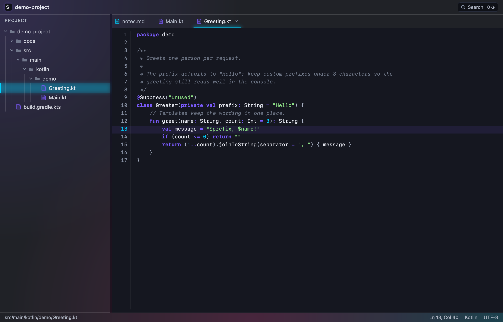
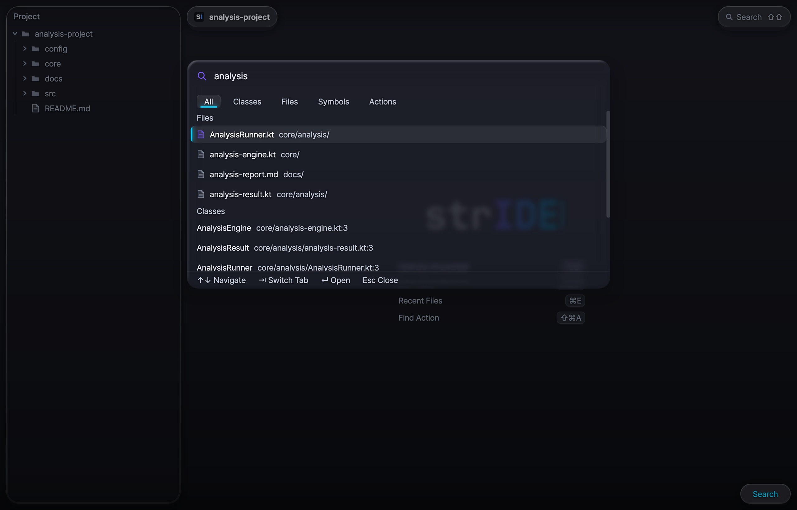
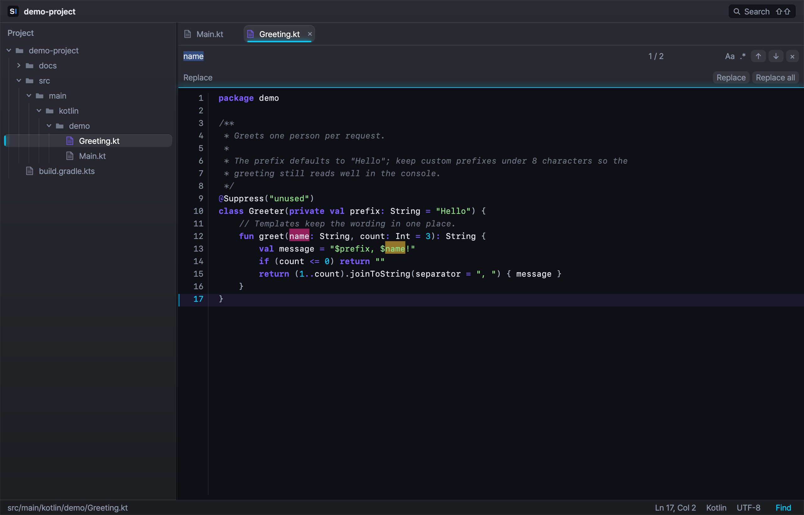
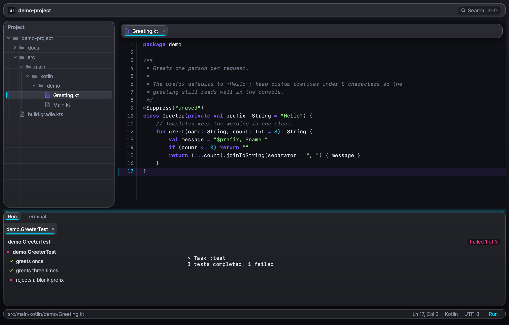
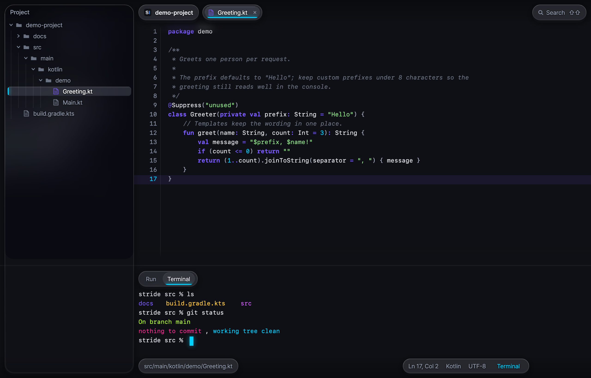
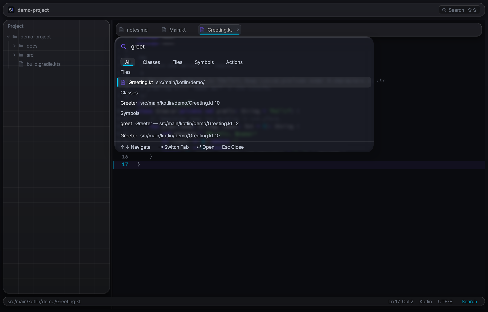
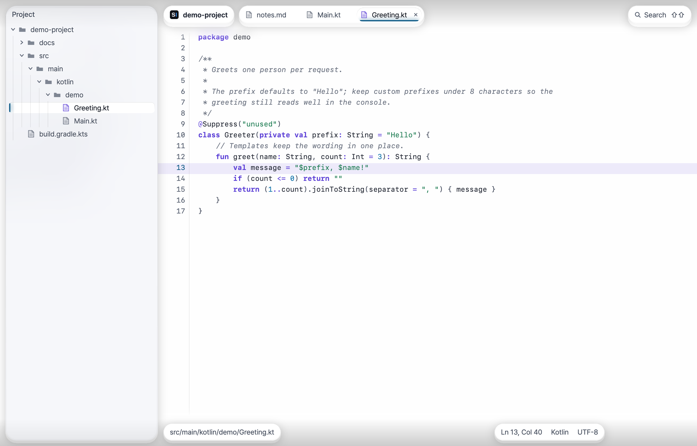

<h1 align="center">strIDE</h1>

<p align="center">키보드로 다루는 macOS 코드 에디터.</p>

<p align="center"><b>한국어</b> · <a href="README.en.md">English</a></p>

<p align="center">
  <a href="https://github.com/lcalmsky/stride/releases/latest"></a>
  
  <a href="LICENSE"></a>
</p>

<p align="center"></p>

<p align="center">
  프로젝트 트리 &nbsp;·&nbsp; 탭 에디터 &nbsp;·&nbsp; Kotlin·JSON 문법 하이라이트 &nbsp;·&nbsp; 찾기와 바꾸기 &nbsp;·&nbsp; 리퀴드 글래스 UI<br>
  Kotlin 과 Compose Desktop 으로 만든 Apple Silicon 전용 앱입니다.
</p>

<br>

## 빠른 시작

```sh
brew tap lcalmsky/stride https://github.com/lcalmsky/stride
brew trust lcalmsky/stride
brew install --cask lcalmsky/stride/stride
```

앱은 `/Applications/strIDE.app` 에 설치됩니다. Apple Silicon(arm64) 전용이고, 번들 런타임이 들어 있어 JDK 를 따로 설치하지 않아도 됩니다.

<br>

## 기능

### 에디터

<table width="100%">
<tr>
<td width="44%" valign="top"></td>
<td valign="top">

- **프로젝트 트리** 폴더는 한 번 클릭에 펼치고 파일은 한 번 클릭에 엽니다. `.git`, `build`, `.gradle`, `node_modules`, `.kotlin`, `.idea` 는 숨깁니다. 경계를 끌어 너비를 200–480 dp 사이에서 바꾸고, `⌘1` 로 트리를 여닫고 `⌥F1` 로 현재 파일을 트리에서 드러냅니다
- **탭 에디터** 연 파일이 탭으로 열리고, 같은 파일을 다시 열면 그 탭을 고릅니다. 탭은 `⌘W` 로 닫고 `⌘⇧]`·`⌃→` 와 `⌘⇧[`·`⌃←` 로 오갑니다. 닫은 탭과 나머지 탭은 Actions 탭의 `Reopen Closed Tab`·`Close Other Tabs` 로 다룹니다
- **문법 하이라이트** Kotlin 플러그인과 JSON 플러그인이 각각 렉서와 하이라이터를 제공합니다. 2 MB 를 넘는 파일은 하이라이트 없이 읽기 전용으로 엽니다
- **편집** 줄 복제·삭제·이동, 줄·블록 주석 토글, 들여쓰기, 실행 취소·다시 실행을 키보드로 합니다. `⌘L` 로 `줄` 이나 `줄:열` 로 이동합니다. 선택 없이 `⌘C`·`⌘X` 를 누르면 줄 전체를 복사·잘라냅니다
- **편집 도우미** `⌥↑`·`⌥↓` 는 커서에서 단어·문자열·괄호·줄 순으로 선택을 넓히고 좁힙니다. `⌘⇧U` 대소문자, `⌃⇧J` 줄 합치기, `⇧↩`·`⌘⌥↩` 새 줄, `⌃M` 짝 괄호, `⌘⌥[`·`⌘⌥]` 코드 블록, `⌃⇧↑`·`⌃⇧↓` 메서드 이동을 키보드로 합니다. `⌥/` 는 열린 편집기의 단어로, `⌃Space`·`⌃⌥Space` 는 선언 인덱스와 키워드로 자동 완성하고, `⇧F6` 은 파일 안에서 이름을 바꿉니다
- **탐색** `⌘B` 나 `⌘`-클릭으로 선언으로 가고, `⌘[`·`⌘]` 또는 `⌘⌥←`·`⌘⌥→` 로 뒤로·앞으로 갑니다. `⌘F12` 파일 구조, `⌘⇧T` 테스트로 이동, `⌥F7` 사용처 찾기, `F3`·`⌘F3` 북마크를 씁니다
- **상태 캡슐** 하단의 경로 캡슐은 상대 경로를, 상태 캡슐 그룹은 `Ln`·`Col`, 파일 종류, `UTF-8`, 읽기 전용 표시를 보여 줍니다

</td>
</tr>
</table>

### 검색

<table width="100%">
<tr>
<td width="44%" valign="top"></td>
<td valign="top">

- **Search Everywhere** `Shift` 를 두 번 누르면 All 탭으로 열립니다. 파일·클래스·심볼·액션 결과를 묶어 보여 주고(`Files`·`Classes` 같은 그룹, 기여자별 4개·전체 50개까지), `Tab`·`⇧Tab` 으로 All·Classes·Files·Symbols·Actions 탭을 오갑니다. `↑`·`↓` 로 옮기고 `Enter` 로 엽니다
- **클래스·심볼** `⌘O` 는 클래스, `⌘⌥O` 는 심볼 검색을 엽니다. 백그라운드 선언 인덱스가 Kotlin·Java 의 클래스·함수·프로퍼티를 훑어 클래스는 `경로:줄`, 심볼은 `컨테이너 — 경로:줄` 을 보여 주고 `Enter` 로 그 줄을 엽니다
- **파일로 이동** `⌘⇧O` 는 파일 이름과 상대 경로를 퍼지 매칭해 점수 순으로 보여 줍니다
- **액션** `⌘⇧A` 는 모든 액션을 이름과 단축키로 보여 주고 `Enter` 로 실행합니다
- **프로젝트 텍스트 검색** `⌘⇧F` 는 프로젝트의 파일에서 글자를 찾습니다. 2 MB 가 넘는 파일과 바이너리 파일은 건너뛰고 최대 200건을 보여 줍니다. `W` 는 단어 단위 일치를 켭니다. 결과는 `경로:줄` 과 줄 내용으로 나오고 일치한 글자는 강조됩니다. `Enter` 로 파일을 열고 그 위치를 선택합니다
- **최근 파일** `⌘E` 는 최근에 연 파일을 최신 순으로 최대 50개 보여 줍니다. 닫은 파일도 목록에 남습니다

</td>
</tr>
</table>

### 찾기

<table width="100%">
<tr>
<td width="44%" valign="top"></td>
<td valign="top">

- **찾기 바** `⌘F` 로 상단 캡슐 줄 아래에 엽니다. `Enter`·`⌘G` 는 다음 일치로, `⇧Enter`·`⌘⇧G` 는 이전 일치로 이동하고 끝에서 반대편으로 돌아갑니다
- **바꾸기** `⌘R` 로 바꾸기 줄을 펼칩니다. 현재 일치나 전체를 바꿉니다
- **옵션** `Aa` 는 대소문자를 구분하고 `.*` 는 정규식을 씁니다. 정규식 바꾸기에서는 `$1` 로 그룹을 참조합니다. 잘못된 정규식은 오류를 보여 줍니다
- **표시** 현재 일치와 나머지 일치를 서로 다른 네온 색으로 칠하고 `n / 전체` 카운터를 보여 줍니다. `Esc` 로 닫고 에디터로 포커스를 돌려줍니다

</td>
</tr>
</table>

### Run

<table width="100%">
<tr>
<td width="44%" valign="top"></td>
<td valign="top">

- **테스트 실행** `src/test` 아래 `.kt` 파일의 클래스 줄과 `@Test` 함수마다 거터에 `▶` 가 붙습니다. 눌러서 그 테스트를 실행합니다. `⌃⇧R` 은 커서 위치의 테스트를, 없으면 파일의 main 이나 스크립트를 실행합니다
- **main 실행** Kotlin·Java 의 `main` 함수 줄에도 거터 `▶` 가 붙습니다. `⌃R` 은 마지막 실행이 있으면 다시 실행하고, 없으면 `⌃⇧R` 과 같은 대상을 실행합니다. `.py`·`.sh`·`.js`·`.rb`·`.kts` 스크립트와 Gradle 밖 단일 Java 파일은 직접 실행하고, Gradle 소스셋의 Kotlin·Java 는 `strideRunMain` 작업으로 실행합니다
- **컨텍스트 액션과 실행 구성** `⌥↩` 는 커서 위치에서 실행할 main·테스트와 다시 실행·중지를 팝업으로 보여 줍니다. `⌃⌥R` 은 현재 파일의 실행 항목과 최근 실행 10개를 보여 주고 `Enter` 로 실행합니다. `⌘F9` 는 `classes`·`testClasses` 를 빌드합니다
- **Run 창** 실행 세션이 둘 이상이거나 끝난 세션이 있으면 창 위에 탭이 생기고 `×` 로 닫습니다. 테스트 실행은 트리와 콘솔로 나눠 통과·실패·건너뜀 수를 세고, 메서드를 고르면 메시지와 스택, 그 테스트의 출력을 보여 줍니다. 애플리케이션 실행은 콘솔만 보여 주며 콘솔 아래 입력 줄로 표준 입력을 보냅니다. `⌘F2` 로 중지하고 `⌘R` 로 다시 실행하며 `⌘4` 로 창을 엽니다
- **항상 실행** Gradle init script 가 `Test` 작업의 최신 검사와 빌드 캐시를 끕니다. 같은 테스트를 다시 돌려도 건너뛰지 않고 이벤트를 보고합니다

</td>
</tr>
</table>

### 터미널

<table width="100%">
<tr>
<td width="44%" valign="top"></td>
<td valign="top">

- **내장 터미널** `⌥F12` 로 Terminal 창을 엽니다. 프로젝트 디렉터리에서 로그인 셸을 실제 PTY(pty4j)로 띄우고 jediterm 이 화면을 그립니다
- **네온 ANSI 팔레트** 16색 ANSI 팔레트가 나머지 화면과 같은 네온 계열입니다. 커서는 `accent2` 색입니다
- **숨기기** `⇧Esc` 로 창을 숨기고 포커스를 원래 자리로 돌려줍니다

</td>
</tr>
</table>

### 리퀴드 글래스 UI

<table width="100%">
<tr>
<td width="44%" valign="top"></td>
<td valign="top">

- **시스템 유리** macOS 26 이상에서는 창 콘텐츠 뒤에 시스템의 유리 뷰를 깔아, 사이드바·캡슐·찾기 바·팝업으로 데스크톱과 다른 창이 비칩니다. 에디터와 콘솔은 그 위에 뜬 불투명한 둥근 판입니다
- **제목 줄** 제목 줄을 숨기고 신호등을 상단 캡슐 줄에 맞춥니다. 그 줄의 빈 곳을 끌면 창이 움직이고, 두 번 누르면 시스템의 제목 줄 두 번 클릭 설정을 따릅니다
- **라이트·다크** 시스템 외관을 실행 중에 따라갑니다. 팔레트와 문법 색, 터미널 색에 라이트·다크 두 벌이 있어 앱을 다시 시작하지 않아도 바뀝니다
- **이전 macOS** macOS 26 미만이거나 네이티브 라이브러리가 없으면 이전의 창 안 유리와 표준 제목 줄을 씁니다
- **배경** 네이티브 유리가 꺼진 경로에서는 중립 그라파이트 바탕에 위에서 아래로 은은히 어두워지는 휘도 폴오프를 깔아 창 뒤에 둡니다. 색은 강조 요소에만 씁니다
- **조작 층에만 유리** 유리는 사이드바·상하단 캡슐·찾기 바·팝업·도구 창 전환기처럼 조작에 쓰는 층에만 쓰고, 코드는 창 가장자리까지 채웁니다. 바나 판이 창을 가로지르지 않습니다
- **떠 있는 유리 사이드바** 위·왼·아래 10 dp 띄운 둥근 유리 판입니다. 대체 경로에서는 바로 옆의 실제 코드를 뒤집어 흐린 색장을 판 아래에 깔아 사이드바가 옆 코드의 색조를 머금고, 판 바깥은 에디터 필드와 같은 픽셀로 남습니다. 네이티브 경로에서는 판 자체가 데스크톱을 비춥니다
- **바 대신 캡슐** 상단은 프로젝트 이름 캡슐·탭 캡슐 그룹·Search 캡슐로, 하단은 파일 경로 캡슐과 상태 캡슐 그룹으로 나뉩니다. 선택한 탭은 그룹 안의 유리 필이 미끄러지듯 옮겨 가고 시안 2 dp 밑줄이 선택을 즉시 알립니다. 상태 캡슐 그룹은 `Ln`·`Col`, 파일 종류, `UTF-8`, 읽기 전용 표시를 담습니다. 캡슐은 뒤를 흐려 라벨을 읽히게 하고, 캡슐 사이의 빈 곳은 그 아래(대체 경로에서는 코드)가 그대로 보이고 클릭됩니다
- **스크롤 엣지 효과** 스크롤한 코드는 상단·하단 캡슐 줄 아래에서 서서히 흐려지며 창 가장자리로 사라집니다. 바가 덮어 자르는 대신 흐림이 점진적으로 풀립니다
- **얇은 팝업** 대체 경로에서는 Search Everywhere·최근 파일·컨텍스트 액션 팝업이 코드 위에 얇은 유리로 뜨고, 뒤의 코드를 비추며 가장자리에서 휘게 합니다. 굵은 텍스트 그림자가 라벨을 읽히게 하고, 셰이더를 쓸 수 없으면 블러와 헤어라인으로 대체합니다. 네이티브 경로에서는 팝업도 시스템 유리로 뜹니다
- **웰컴 화면** 프로젝트가 없으면 워드마크가 화면의 콘텐츠가 되고, 그 아래 `Open Folder…` 유리 캡슐과 키캡 힌트가 놓입니다
- **선택 신호** 선택한 트리 행은 작은 렌즈가 든 캡슐로 떠오르고, 시안 2 dp 막대, 번지는 글로우, 흰 텍스트로 표시합니다. 포커스를 받은 트리 패널은 테두리에 얇은 선을 그립니다
- **큰 파일** 1,000줄 이상 문서는 상수 비용 스크롤 레이어로 그려 프레임 비용을 묶고, 그때 캡슐은 캐시한 프로스트 채움을 씁니다. 800줄 아래로 줄어야 레이어를 풉니다
- **모션과 비용** 선택한 탭의 필은 200 ms 동안 미끄러지고 상시 애니메이션은 없습니다. 캡슐 프로스트와 팝업 렌즈는 저해상도 사본에서 계산하고, 배경 확장과 스크롤 엣지 흐림은 결과를 캐시해 정지 프레임에서 다시 계산하지 않습니다
- **UI 글꼴** 번들된 UI 글꼴을 쓰고, Actions 탭의 `Switch UI Font` 로 시스템 글꼴과 전환합니다. 선택은 저장되어 다음 실행에도 유지됩니다

</td>
</tr>
</table>

<p align="center"></p>

<p align="center"></p>

<br>

## 사용법

### 키보드

아래는 기본 키입니다. 단축키는 IntelliJ IDEA 의 macOS 기본 키맵과 호환됩니다. macOS 가 아닌 플랫폼에서는 Command 와 Control 이 서로 바뀌어(`⌘S` 는 `Ctrl+S`, `⌃R` 은 `Meta+R`) `Ctrl`·`Alt`·`Shift`·`Meta` 라벨로 표시됩니다. 전체 목록과 문맥별 우선순위의 정본은 `app/src/main/kotlin/stride/app/keys/Keymap.kt` 의 `bind(` 호출입니다.

| 키 | 동작 |
|---|---|
| **파일과 탭** | |
| `⌘S` | 저장 |
| `⌘W` | 탭 닫기 |
| `⌘⇧]` `⌃→` / `⌘⇧[` `⌃←` | 다음 탭 / 이전 탭 |
| `⌘1` / `⌘⇧F12` | 프로젝트 트리 여닫기 / 모든 도구 창 숨기기·복원 |
| Actions 탭 | Reopen Closed Tab · Close Other Tabs |
| **검색과 이동** | |
| `⇧⇧` | Search Everywhere (All 탭) |
| `⌘O` | 클래스로 이동. 프로젝트가 없으면 폴더 열기 |
| `⌘⇧O` / `⌘⌥O` | 파일 / 심볼로 이동 |
| `⌘⇧A` | 액션으로 이동 |
| `⌘⇧F` | 프로젝트 텍스트 검색 |
| `⌘E` / `⌃Tab` `⌃⇧Tab` | 최근 파일 / 최근 파일 전환기 |
| `⌥F1` / `⌘⇧C` / `⌘⌥⇧C` | 트리에서 현재 파일 드러내기 / 경로 복사 / 참조 복사 |
| **에디터 편집** | |
| `⌘D` | 줄 또는 선택 복제 |
| `⌘⌫` | 줄 삭제 |
| `⌥⇧↑` / `⌥⇧↓` | 줄 위로 이동 / 아래로 이동 |
| `⌘/` · `⌘⌥/` | 줄 주석 토글 · 블록 주석 토글 |
| `Tab` / `⇧Tab` | 들여쓰기 / 내어쓰기 |
| `⌘L` | 줄로 이동 |
| `Esc` | 줄로 이동 닫기, 선택을 커서로 접기 |
| `⌘Z` / `⌘⇧Z` | 실행 취소 / 다시 실행 |
| `⌥↑` / `⌥↓` | 선택 넓히기 / 좁히기 |
| `⌘⇧U` | 대소문자 바꾸기 |
| `⌃⇧J` | 줄 합치기 |
| `⇧↩` / `⌘⌥↩` | 아래 / 위에 새 줄 |
| `⌃M` | 짝 괄호로 이동 |
| `⌘⌥[` / `⌘⌥]` | 코드 블록 시작 / 끝으로 이동 |
| `⌃⇧↑` / `⌃⇧↓` | 위 / 아래 메서드로 이동 |
| `⌥/` | 단어 자동 완성 |
| `⌃Space` · `⌃⌥Space` | 자동 완성 팝업 |
| `⇧F6` | 파일 안에서 이름 바꾸기 |
| `⌘C` / `⌘X` | 선택 없이 줄 복사 / 잘라내기 |
| **찾기** | |
| `⌘F` | 찾기 바 열기 |
| `⌘R` | 바꾸기 줄 펼치기 |
| `⌘G` / `⌘⇧G` | 다음 일치 / 이전 일치 |
| **탐색** | |
| `⌘B` · `⌘`-클릭 | 선언으로 이동 |
| `⌘[` `⌘⌥←` / `⌘]` `⌘⌥→` | 뒤로 / 앞으로 |
| `⌘F12` | 파일 구조 |
| `⌘⇧T` | 테스트로 이동 |
| `⌥F7` | 사용처 찾기 |
| `F3` / `⌘F3` | 북마크 토글 / 북마크 목록 |
| **Run** | |
| `⌥↩` | 컨텍스트 액션 |
| `⌃⇧R` | 커서 위치의 테스트, 없으면 파일의 main 실행 |
| `⌃R` | 마지막 실행 다시 실행, 없으면 커서 위치의 테스트나 파일의 main 실행 |
| `⌃⌥R` | 실행 구성 선택 |
| `⌘F9` | 빌드 |
| `⌘F2` | 실행 중지 |
| `⌘4` · `⌘R` (Run 창) | Run 창 열기 · Run 창에서 다시 실행 |
| **터미널** | |
| `⌥F12` | Terminal 창 열기 |
| `⇧Esc` | 도구 창 숨기기 (Terminal·Run 창) |
| **기타** | |
| Actions 탭 | Switch UI Font |

<br>

## 설치

### Homebrew

```sh
brew tap lcalmsky/stride https://github.com/lcalmsky/stride
brew trust lcalmsky/stride
brew install --cask lcalmsky/stride/stride
```

같은 저장소를 tap 으로 쓰고 Cask 는 `Casks/stride.rb` 에 있습니다. 짧은 이름 `stride` 는 다른 tap 과 겹칠 수 있어 `lcalmsky/stride/stride` 전체 이름으로 설치합니다. `brew trust` 는 공식 tap 이 아닌 tap 의 Cask 를 Homebrew 가 불러올 수 있게 신뢰 처리합니다.

### 소스에서 빌드

```sh
git clone https://github.com/lcalmsky/stride.git
cd stride
./gradlew :app:run                       # 개발 실행
./gradlew :app:createDistributable       # app/build/compose/binaries/main/app/strIDE.app
```

JDK 21 이 필요합니다. Gradle toolchain 이 21 을 요구합니다.

### 필요 조건

| 조건 | 비고 |
|---|---|
| macOS Apple Silicon (arm64) | 릴리즈 앱은 arm64 전용입니다. 번들 런타임이 들어 있어 JDK 설치가 필요 없습니다 |
| macOS 26 이상 (선택) | 시스템 유리를 쓰는 조건입니다. 그보다 낮으면 앱 안에서 그리는 유리로 동작합니다 |
| JDK 21 | 소스에서 빌드할 때만 필요합니다 |
| Gatekeeper | zip 을 직접 받아 풀면 첫 실행에서 경고가 뜰 수 있습니다. Finder 에서 앱을 우클릭하고 `열기` 를 고릅니다 |

<br>

## 동작 방식

앱은 여섯 모듈로 나뉩니다. `core` 는 서비스·확장점·`Disposer` 를 제공하고, `lang` 은 언어와 파일 종류·하이라이터·주석 처리 API 를 정의합니다. `search` 는 파일 이름 인덱스, Kotlin·Java 선언 인덱스, Search Everywhere 의 모델을, `app` 은 Compose Desktop UI 와 에디터·탐색·북마크·Run·터미널을 담습니다. `plugins/lang-kotlin` 과 `plugins/lang-json` 이 각각 Kotlin 과 JSON 의 렉서·하이라이터·파일 종류를 등록합니다.

모든 모듈은 `META-INF/stride-plugin.xml` 디스크립터로 확장점을 선언하고 확장을 등록합니다. 앱 디스크립터가 파일 종류, 문법 하이라이터, 주석 처리, 에디터, 트리 구조, Search Everywhere 기여자 확장점을 열고, 언어 플러그인과 앱 자신이 그 확장점에 등록합니다. 클래스·심볼 검색은 선언 인덱스를 읽는 기여자로 등록되고, 액션 검색은 앱이 직접 구성합니다. 자세한 계약은 [core](docs/api-core.md) · [lang](docs/api-lang.md) · [search](docs/api-search.md) · [app](docs/api-app.md) 에 있습니다.

에디터는 스크롤 뷰포트와 크롬 인셋을 따로 둡니다. 내용은 창 가장자리까지 이어지고 유리 캡슐과 사이드바가 그 위에 떠 있으며, 인셋은 캐럿 스크롤·거터·스크롤바 여백에 반영됩니다. 1,000줄 이상 문서는 내용을 별도 스크롤 레이어에 배치하고 800줄 아래로 내려가면 레이어를 풉니다.

네이티브 경로에서는 JNI 라이브러리가 창 콘텐츠 아래에 시스템 유리 뷰를 배치하고 Compose 는 그 위의 조각들만 보고합니다. 라이브러리가 없거나 macOS 26 미만이면 같은 조각 정보를 Skia 재질로 그리는 경로로 대체합니다.

<br>

## 개발

```sh
./gradlew test                    # 테스트. 실패 0 이어야 합니다
./gradlew :app:createDistributable
./gradlew :app:run                # 창을 띄우므로 직접 실행합니다
```

- 테스트는 580여 건이고 약 2분 걸립니다. `UiSnapshotTest` 가 `app/build/ui-snapshots/` 에 화면 PNG 를 씁니다
- `:app:buildNativeGlass` 는 `clang++`(Xcode Command Line Tools)가 있을 때만 실행됩니다. 없으면 한 줄 로그를 남기고 앱은 Skia 유리 경로로 동작합니다. `-Pstride.nativeGlass=false` 로 네이티브 빌드를 건너뛸 수 있습니다
- 릴리즈는 `scripts/release.sh X.Y.Z -m "<바뀐 기능 요약>"` 하나로 합니다. `scripts/release-selftest.sh` 가 이 스크립트를 검사합니다
- 저장소 규칙은 [CLAUDE.md](CLAUDE.md) 에 있습니다

<br>

<p align="center"><a href="LICENSE">MIT</a></p>
